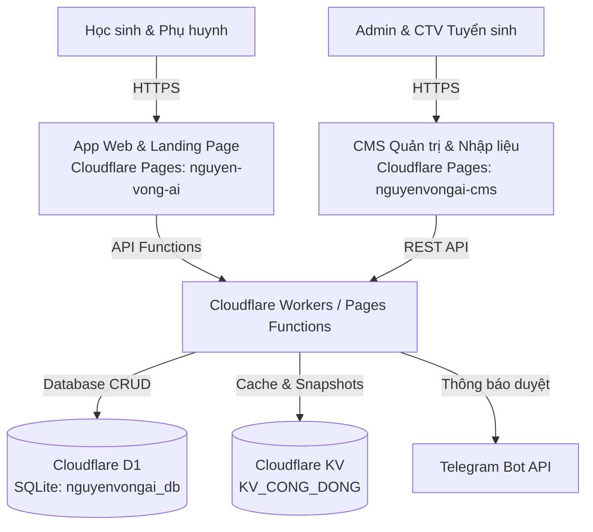

# 🎓 Nguyện Vọng AI

> **Nền tảng định hướng nguyện vọng & kế hoạch học tập cá nhân hóa cho học sinh THPT (15–18 tuổi).**  
> Giúp học sinh trả lời 4 câu hỏi cốt lõi: *Mình đang ở đâu? Muốn đi tới đâu? Còn cách bao xa? Hôm nay làm gì?*

---

## 🌐 Tên Miền Trực Tiếp (Live Production URLs - Cloudflare Pages)

| Phân hệ / Màn hình | Tên miền trực tiếp | Trạng thái |
|---|---|---|
| **App Học sinh** | [https://nguyen-vong-ai.pages.dev](https://nguyen-vong-ai.pages.dev) | 🟢 Đang hoạt động (Online) |
| **Landing Page** | [https://nguyen-vong-ai.pages.dev/#/gioi-thieu](https://nguyen-vong-ai.pages.dev/#/gioi-thieu) | 🟢 Đang hoạt động (Online) |
| **CMS Quản trị Tuyển sinh** | [https://nguyenvongai-cms.pages.dev](https://nguyenvongai-cms.pages.dev) | 🟢 Đang hoạt động (Online) |

---

## 💻 Địa Chỉ Chạy Cục Bộ (Localhost)
| Phân hệ / Màn hình | Địa chỉ Localhost | Lệnh khởi động |
|---|---|---|
| **App Học sinh** | [http://localhost:3030](http://localhost:3030) | `npm run dev` |
| **Landing Page** | [http://localhost:3030/#/gioi-thieu](http://localhost:3030/#/gioi-thieu) | `npm run dev` |
| **CMS Quản trị Tuyển sinh** | [http://localhost:3031](http://localhost:3031) | `npm run cms:dev` |
| **Mock API CMS Backend** | [http://localhost:8787](http://localhost:8787) | `npm run cms:api` |

---

## 🏗️ Kiến Trúc Hệ Thống (3-Tier Serverless)

Dự án được xây dựng trên nền tảng **Cloudflare Serverless Ecosystem**:



1. **Ứng dụng Học sinh (Web Client & Landing Page)**:
   - Single-Page Application (React 19 + TypeScript + Tailwind CSS).
   - Thiết kế Mobile-first (390px / 360px), Light Mode Solid, Zero Glassmorphism.
   - Hoạt động mượt mà offline / local-first qua `localStorage` và đồng bộ khi có mạng.
2. **Hệ thống Quản trị Tuyển sinh (CMS)**:
   - Cổng thông tin cho Quản trị viên & Cộng tác viên nhập liệu điểm chuẩn, học phí, đề án tuyển sinh.
   - Luồng dữ liệu nghiêm ngặt: `Bản nháp (Draft) ➔ Gửi duyệt (Submitted) ➔ Đã duyệt (Approved) ➔ Xuất bản (Published)`.
3. **Cơ sở dữ liệu & Serverless Backend**:
   - **Cloudflare D1 (`nguyenvongai_db`)**: Lưu trữ bản ghi trường, ngành, điểm chuẩn nhiều năm, người dùng CMS.
   - **Cloudflare KV (`KV_CONG_DONG`)**: Lưu trữ Snapshot tuyển sinh công khai, Rate-limit, bộ đệm.
   - **Cloudflare Functions**: Xử lý API đăng ký sớm, API CMS và thông báo Telegram.

---

## 🚀 Hướng Dẫn Triển Khai (Deployment Guide)

Dự án được triển khai lên **Cloudflare Pages** thông qua **Wrangler CLI**.

### 1. Triển khai Ứng dụng Học sinh (Web App & Landing Page)
- **Tên project Cloudflare Pages:** `nguyen-vong-ai`
- **Tệp cấu hình:** `wrangler.jsonc`

```bash
# Bước 1: Build mã nguồn ứng dụng web
npm run build

# Bước 2: Deploy lên Cloudflare Pages
npm run deploy
# hoặc chạy trực tiếp qua wrangler:
npx wrangler deploy
```

---

### 2. Triển khai Hệ thống Quản trị CMS
- **Tên project Cloudflare Pages:** `nguyenvongai-cms`
- **Tệp cấu hình:** `cms/wrangler.jsonc`

```bash
# Bước 1: Build mã nguồn CMS
npm run cms:build

# Bước 2: Deploy thư mục cms/dist lên Cloudflare Pages
npx wrangler pages deploy cms/dist --project-name=nguyenvongai-cms
```

---

### 3. Thiết lập Cơ sở dữ liệu Cloudflare D1 & KV

```bash
# 1. Khởi tạo / chạy migration D1 trên môi trường Production
npx wrangler d1 migrations apply nguyenvongai_db --remote

# 2. (Tùy chọn) Nạp dữ liệu trường chính thức vào D1 Remote
npx tsx scripts/khoi-tao-d1-that.ts
npx wrangler d1 execute nguyenvongai_db --remote --file=.wrangler/seed-d1.sql

# 3. Tạo KV namespace cho Rate Limit và Cache
npx wrangler kv namespace create KV_CONG_DONG
```

---

### 4. Cấu hình Biến Môi trường & Secret (Bindings)

| Tên Binding | Loại | Mục đích |
|---|---|---|
| `DB` | D1 Database | Kết nối database `nguyenvongai_db` |
| `KV_CONG_DONG` | KV Namespace | Lưu Snapshot xuất bản & Rate limit |
| `TELEGRAM_BOT_TOKEN` | Secret | Token bot Telegram gửi thông báo duyệt CMS |
| `TELEGRAM_CHAT_ID` | Secret | ID nhóm Telegram nhận thông báo |

```bash
# Đặt secret cho Telegram Bot
npx wrangler secret put TELEGRAM_BOT_TOKEN
npx wrangler secret put TELEGRAM_CHAT_ID
```

---

## 💻 Chạy Cục Bộ (Local Development)

```bash
# Cài đặt dependencies
npm install

# 1. Chạy Web Client (cổng 3030)
npm run dev

# 2. Chạy CMS Client (cổng 3031)
npm run cms:dev

# 3. Chạy Mock API Server cho CMS Local (cổng 8787)
npm run cms:api
```

---

## 🧪 Kiểm Thử & Kiểm Soát Chất Lượng (Quality Gate)

Trước khi commit hoặc deploy, luôn chạy bộ 4 lệnh kiểm tra:

```bash
# 1. Kiểm tra Type TypeScript
npx tsc --noEmit

# 2. Kiểm tra đồng nhất (Route, token màu, từ cấm tiếng Việt)
npm run kiem-tra

# 3. Chạy toàn bộ Test Suite (Engine, D1, CMS workflow, Điểm thi)
npm test

# 4. Kiểm tra Build Production Web & CMS
npm run build
npm run cms:build
```

---

## 📜 Quy Ước Đặt Tên & Cấu Trúc Mã Nguồn

- **Kebab-case thuần Việt không dấu:** Toàn bộ file và thư mục theo phong cách tiếng Việt (`duong-dan.ts`, `tinh-toan.ts`, `khoi-dau/`, `ke-hoach/`, `he-thong/`).
- **Giao diện chuẩn Light Mode:** Không dùng glassmorphism, tương phản cao, nút mobile tối thiểu 48px, chữ rõ ràng không rớt dòng.
- **Nguồn sự thật dữ liệu:** Dữ liệu điểm chuẩn và học phí lấy từ đề án chính thức có nguồn đối chiếu, không suy đoán.
