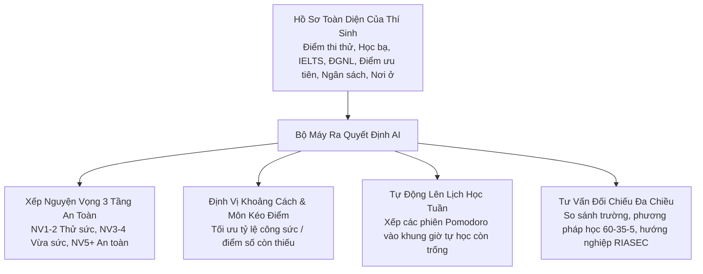
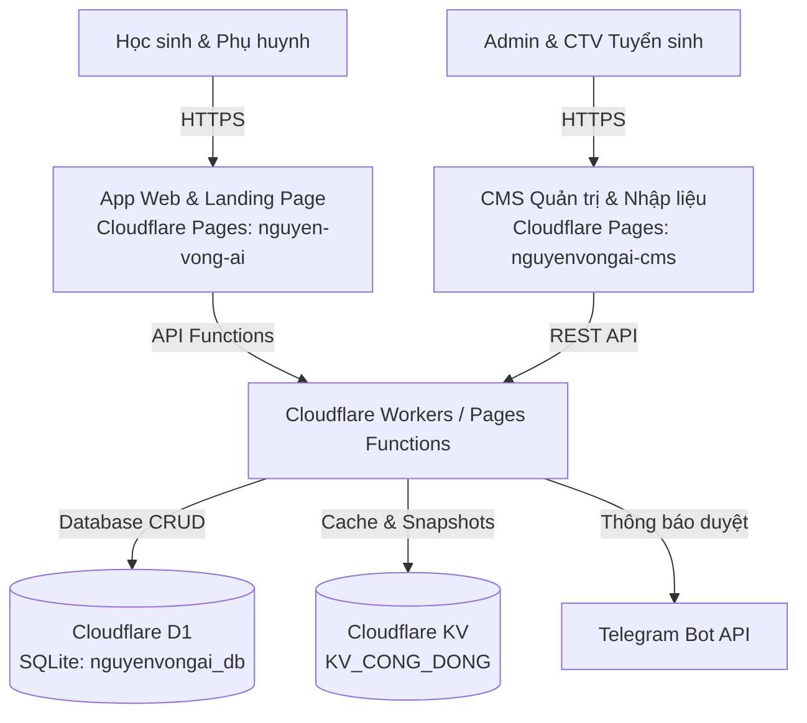

# 🎓 Nguyện Vọng AI

> **Nền tảng định hướng nguyện vọng & kế hoạch học tập cá nhân hóa cho học sinh THPT (15–18 tuổi).**  
> Giúp học sinh trả lời 4 câu hỏi cốt lõi: *Mình đang ở đâu? Muốn đi tới đâu? Còn cách bao xa? Hôm nay làm gì?*

---

## 🌐 Tên Miền Trực Tiếp (Live Production URLs - Cloudflare Pages)

| Phân hệ / Màn hình | Tên miền trực tiếp | Trạng thái |
|---|---|---|
| **App Học sinh** | [https://nguyen-vong-ai.pages.dev](https://nguyen-vong-ai.pages.dev) | 🟢 Đang hoạt động (Online) |
| **Landing Page** | [https://nguyen-vong-ai.pages.dev/#/gioi-thieu](https://nguyen-vong-ai.pages.dev/#/gioi-thieu) | 🟢 Đang hoạt động (Online) |
| **CMS Quản trị Tuyển sinh** | [https://nguyenvongai-cms.pages.dev](https://nguyenvongai-cms.pages.dev) | 🟢 Đang hoạt động (Online) |

---

## Bộ dữ liệu tuyển sinh (số đo thực)

Hệ thống sở hữu cơ sở dữ liệu đối soát thực tế từ Đề án tuyển sinh chính thức của Bộ Giáo dục & Đào tạo và các cơ sở giáo dục đại học trên cả nước:

- **3.652 chương trình đào tạo** thuộc **118 trường đại học** lớn trên toàn quốc (Hà Nội, TP.HCM, Miền Trung, Tây Nguyên, Đồng bằng Sông Cửu Long).
- **Điểm chuẩn nhiều năm** kèm tổ hợp xét tuyển khi đề án có ghi (A00, A01, B00, C00, D01, D07...). 1.551 chương trình lấy từ đề án PDF, 2.101 từ trang tổng hợp (nguồn thứ cấp).
- **Học phí theo năm: 721 chương trình ở 20 trường**, mỗi dòng kèm link đề án và số trang; 75 dòng là mức chung cả trường. Chương trình còn lại ghi "chưa có".
- **Tỷ lệ có việc làm: 121 chương trình**, trích từ đề án; còn lại ghi "chưa có".
- **Nguồn**: mọi con số hiển thị đều kèm link; thiếu thì nói thiếu, không điền thay. Kiểm đếm: `python -I scripts/kiem-dinh-du-lieu.py`.

---

## 🧠 Bộ Máy AI Ra Quyết Định Toàn Diện (Decision Intelligence)

Khác với các chatbot AI thông thường (thường bị ảo giác giữa điểm sàn và điểm chuẩn, không hiểu sâu lịch học cá nhân), Nguyện Vọng AI mang lại giá trị ra quyết định thực tế vượt trội:



1. **Chiến lược Xếp nguyện vọng 3 tầng thông minh**:
   - Tối ưu hóa xác suất trúng tuyển theo quy chế tuyển sinh của Bộ GD&ĐT: Tầng 1 (Thử sức/Vươn tới ở NV1–NV2), Tầng 2 (Vừa sức ở NV3–NV4), Tầng 3 (An toàn/Dự phòng ở NV5+).
   - Tự động phát hiện và cảnh báo rủi ro (đặt ngành điểm thấp lên trước ngành điểm cao, thiếu ngành an toàn dẫn đến nguy cơ trượt sạch).
2. **Định vị khoảng cách mục tiêu & Thuật toán chọn môn kéo điểm**:
   - Đo lường chính xác số điểm còn thiếu giữa năng lực hiện tại và điểm chuẩn trường mục tiêu.
   - Phân tích độ dốc nỗ lực (effort-to-score slope) để gợi ý môn có biên độ tăng điểm dễ nhất (ví dụ: kéo môn Anh từ 6.5 lên 7.5 tốn ít công sức hơn kéo môn Toán từ 8.5 lên 9.5).
3. **Kế hoạch học tập tuần & Lịch học Pomodoro tự động**:
   - Không chỉ đưa ra lời khuyên định tính, hệ thống tự động nhận diện lịch học trường, học thêm và thời gian nghỉ của thí sinh để xếp các phiên ôn tập môn thiếu điểm vào đúng khung giờ tự học còn trống.
4. **Bộ máy Tư vấn chuyên sâu chống ảo giác (Hallucination-free Advisory)**:
   - Tự động nhận diện mã trường, đối chiếu số liệu đa chiều (học phí, việc làm, điểm chuẩn 3 năm).
   - Tích hợp bài test trắc nghiệm tính cách sở thích RIASEC (Holland Code) giúp học sinh chọn đúng ngành nghề phù hợp với bản thân.

---

## 🏗️ Kiến Trúc Hệ Thống (3-Tier Serverless)

Dự án được xây dựng trên nền tảng **Cloudflare Serverless Ecosystem**:



1. **Ứng dụng Học sinh (Web Client & Landing Page)**:
   - Single-Page Application (React 19 + TypeScript + Tailwind CSS).
   - Thiết kế chuẩn di động Mobile-first (390px / 360px), Light Mode Solid, phong cách tinh giản, trực quan, không rườm rà.
   - Kiến trúc Local-first: Dữ liệu hồ sơ, mục tiêu, nguyện vọng lưu an toàn trên trình duyệt của người dùng qua `localStorage` và đồng bộ tức thời.
2. **Hệ thống Quản trị Tuyển sinh (CMS)**:
   - Cổng thông tin cho Quản trị viên & Đội ngũ CTV tuyển sinh trên cả nước rà soát, cập nhật điểm chuẩn, học phí, đề án mới.
   - Luồng duyệt dữ liệu nghiêm ngặt: `Bản nháp (Draft) ➔ Gửi duyệt (Submitted) ➔ Đã duyệt (Approved) ➔ Xuất bản (Published)`.
3. **Cơ sở dữ liệu & Serverless Backend**:
   - **Cloudflare D1 (`nguyenvongai_db`)**: Lưu trữ bản ghi trường, ngành, điểm chuẩn nhiều năm, người dùng CMS.
   - **Cloudflare KV (`KV_CONG_DONG`)**: Lưu trữ Snapshot tuyển sinh công khai, Rate-limit, bộ đệm CDN.
   - **Cloudflare Functions**: Xử lý API đăng ký sớm, API CMS và thông báo Telegram thời gian thực.

---

## 💻 Chạy Cục Bộ (Local Development)

```bash
# Cài đặt dependencies
npm install

# 1. Chạy Web Client (cổng 3030)
npm run dev

# 2. Chạy CMS Client (cổng 3031)
npm run cms:dev

# 3. Chạy Mock API Server cho CMS Local (cổng 8787)
npm run cms:api
```

---

## 🧪 Kiểm Thử & Kiểm Soát Chất Lượng (Quality Gate)

Trước khi commit hoặc deploy, luôn chạy bộ 4 lệnh kiểm tra:

```bash
# 1. Kiểm tra Type TypeScript
npx tsc --noEmit

# 2. Kiểm tra đồng nhất (Route, token màu, kiểm tra xưng hô)
npm run kiem-tra

# 3. Chạy toàn bộ 40 Test Suite (Xếp lịch, Mục tiêu, Tuyển sinh, CMS, Dữ liệu toàn quốc)
npm test

# 4. Kiểm tra Build Production Web & CMS
npm run build
npm run cms:build
```

---

## 🚀 Hướng Dẫn Triển Khai (Deployment Guide)

Dự án được triển khai lên **Cloudflare Pages** thông qua **Wrangler CLI**.

### 1. Triển khai Ứng dụng Học sinh (Web App & Landing Page)
- **Tên project Cloudflare Pages:** `nguyen-vong-ai`
- **Tệp cấu hình:** `wrangler.jsonc`

```bash
npm run build
npm run deploy
# hoặc chạy trực tiếp qua wrangler:
npx wrangler deploy
```

### 2. Triển khai Hệ thống Quản trị CMS
- **Tên project Cloudflare Pages:** `nguyenvongai-cms`
- **Tệp cấu hình:** `cms/wrangler.jsonc`

```bash
npm run cms:build
npx wrangler pages deploy cms/dist --project-name=nguyenvongai-cms
```

---

## 📜 Quy Ước Thiết Kế & Chuẩn Hóa

- **Giao diện thân thiện, hiện đại:** Sử dụng đại từ xưng hô chuẩn mực **"bạn"** xuyên suốt toàn bộ ứng dụng.
- **Tối ưu trải nghiệm (Declutter):** Loại bỏ các dòng mô tả xám rườm rà, tập trung trực tiếp vào số liệu thực tế và hành động cốt lõi.
- **Nguồn sự thật dữ liệu:** điểm chuẩn, học phí, việc làm chỉ hiển thị khi có nguồn; chi tiết và giới hạn ở `docs/DU-LIEU.md`.
