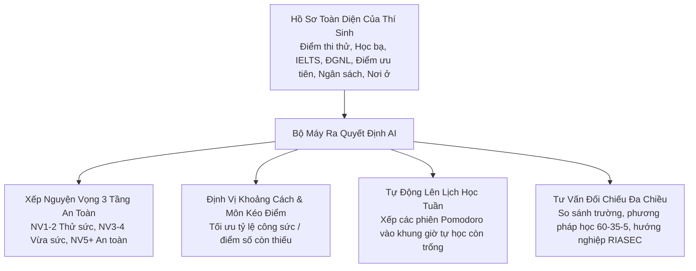
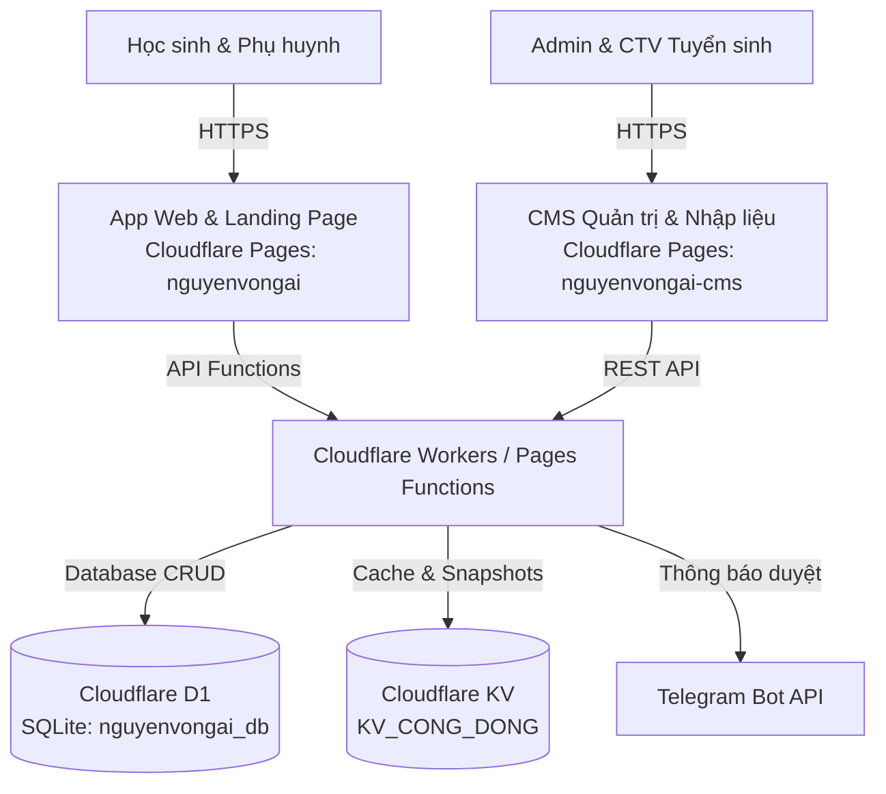

# 🎓 Nguyện Vọng AI

> **Nền tảng định hướng nguyện vọng & kế hoạch học tập cá nhân hóa cho học sinh THPT (15–18 tuổi).**  
> Giúp học sinh trả lời 4 câu hỏi cốt lõi: *Mình đang ở đâu? Muốn đi tới đâu? Còn cách bao xa? Hôm nay làm gì?*

---

## 🌐 Tên Miền Trực Tiếp (Live Production URLs - Cloudflare Pages)

| Phân hệ / Màn hình | Tên miền trực tiếp | Trạng thái |
|---|---|---|
| **App Học sinh** | [https://nguyenvongai.pages.dev](https://nguyenvongai.pages.dev) | 🟢 Đang hoạt động (Online) |
| **Landing Page** | [https://nguyenvongai.pages.dev/#/gioi-thieu](https://nguyenvongai.pages.dev/#/gioi-thieu) | 🟢 Đang hoạt động (Online) |
| **CMS Quản trị Tuyển sinh** | [https://nguyenvongai-cms.pages.dev](https://nguyenvongai-cms.pages.dev) | 🟢 Đang hoạt động (Online) |

---

## 📊 Bộ dữ liệu tuyển sinh (số thật, nói rõ chỗ còn thiếu)

Số liệu lấy từ đề án tuyển sinh của các trường và bảng điểm chuẩn công bố. Không có số nào được sinh ra để "lấp chỗ trống": chỗ nào là ước tính thì app ghi rõ.

- **3.648 chương trình** của **118 trường** (đo 17/10/2026 bằng `npx tsx scripts/so-lieu-nop-bai.mts`; số chốt cho cả đội ở `docs/SO-LIEU-CHOT-NOP-BAI.md`).
- **Điểm chuẩn:** 1.721 chương trình có điểm từ 2 năm trở lên, 1.599 chỉ một năm, 328 xét phương thức khác thi THPT (không so với điểm THPT). 1.492 chương trình gắn nguồn đề án PDF của trường; 2.156 gắn nguồn trang tổng hợp (nguồn thứ cấp, ghi "chưa đối chiếu đề án"). Điểm 2026 có ở 2.082 chương trình, chủ yếu từ trang tổng hợp và VnExpress.
- **Độ chính xác đã đo:** điểm có phần lẻ khớp PDF nguồn ở 201/201 dòng đã kiểm; điểm số nguyên chưa kiểm hết (có lỗi chỉ tiêu bị ghi thành điểm); 146 mục điểm đã sửa có bằng chứng. Xem `docs/audits/do-chinh-xac-du-lieu.md`.
- **Học phí:** 662 chương trình có học phí, toàn bộ theo VnExpress (nguồn thứ cấp, có link). Chương trình khác ghi "Chưa có học phí riêng ngành"; không hiển thị số ước tính.
- **Tỷ lệ có việc làm:** **121** chương trình có số từ đề án; còn lại ghi "chưa có dữ liệu". **Chỉ tiêu theo ngành:** 421 bản ghi của 10 trường.
- **Ngành Sư phạm:** được hỗ trợ học phí và sinh hoạt phí theo Nghị định 116/2020/NĐ-CP nếu cam kết làm việc trong ngành (không thực hiện thì phải bồi hoàn).
- **Dự báo điểm chuẩn 2027:** khoảng thống kê (mô hình học máy đã huấn luyện nhưng đang tắt vì không khớp danh mục điểm hiện tại). Kiểm định bỏ-một-năm (17/10): phủ 91,1% (2023), 93,2% (2024), 76,6% (2025); cả 2.812 dự báo ở mức tin cậy thấp. Chạy lại: `npx tsx tests/du-bao-diem-chuan.test.ts`.
- **Quy tắc:** không chạy script sinh số. Mọi bổ sung đi qua CMS (bắt buộc link nguồn) hoặc script trích từ PDF. Link hỏng ghi ở `scripts/link-hong.txt`; `scripts/danh-dau-uoc-tinh.py` tách số có nguồn khỏi số ước tính.

---

## 🧠 Bộ Máy AI Ra Quyết Định Toàn Diện (Decision Intelligence)

Khác với các chatbot AI thông thường (thường bị ảo giác giữa điểm sàn và điểm chuẩn, không hiểu sâu lịch học cá nhân), Nguyện Vọng AI mang lại giá trị ra quyết định thực tế vượt trội:



1. **Chiến lược Xếp nguyện vọng 3 tầng thông minh**:
   - Cân bằng danh sách theo chênh điểm so với điểm chuẩn năm gần nhất (không phải xác suất đậu): Tầng 1 (Thử sức/Vươn tới ở NV1–NV2), Tầng 2 (Vừa sức ở NV3–NV4), Tầng 3 (An toàn/Dự phòng ở NV5+).
   - Tự động phát hiện và cảnh báo rủi ro (đặt ngành điểm thấp lên trước ngành điểm cao, thiếu ngành an toàn dẫn đến nguy cơ trượt sạch).
2. **Định vị khoảng cách mục tiêu & Thuật toán chọn môn kéo điểm**:
   - Đo số điểm còn thiếu giữa năng lực hiện tại và điểm chuẩn trường mục tiêu.
   - Phân tích độ dốc nỗ lực (effort-to-score slope) để gợi ý môn có biên độ tăng điểm dễ nhất (ví dụ: kéo môn Anh từ 6.5 lên 7.5 tốn ít công sức hơn kéo môn Toán từ 8.5 lên 9.5).
3. **Kế hoạch học tập tuần & Lịch học Pomodoro tự động**:
   - Không chỉ đưa ra lời khuyên định tính, hệ thống tự động nhận diện lịch học trường, học thêm và thời gian nghỉ của thí sinh để xếp các phiên ôn tập môn thiếu điểm vào đúng khung giờ tự học còn trống.
4. **Bộ máy Tư vấn có căn cứ (giảm ảo giác, không loại bỏ hoàn toàn)**:
   - Tự động nhận diện mã trường, đối chiếu số liệu đa chiều (học phí, việc làm, điểm chuẩn 3 năm).
   - Tích hợp bài test trắc nghiệm tính cách sở thích RIASEC (Holland Code) giúp học sinh chọn đúng ngành nghề phù hợp với bản thân.

---

## 🏗️ Kiến Trúc Hệ Thống (3-Tier Serverless)

Dự án được xây dựng trên nền tảng **Cloudflare Serverless Ecosystem**:



1. **Ứng dụng Học sinh (Web Client & Landing Page)**:
   - Single-Page Application (React 19 + TypeScript + Tailwind CSS).
   - Thiết kế chuẩn di động Mobile-first (390px / 360px), Light Mode Solid, phong cách tinh giản, trực quan, không rườm rà.
   - Kiến trúc Local-first: Dữ liệu hồ sơ, mục tiêu, nguyện vọng lưu an toàn trên trình duyệt của người dùng qua `localStorage` và đồng bộ tức thời.
2. **Hệ thống Quản trị Tuyển sinh (CMS)**:
   - Cổng thông tin cho Quản trị viên & Đội ngũ CTV tuyển sinh trên cả nước rà soát, cập nhật điểm chuẩn, học phí, đề án mới.
   - Luồng duyệt dữ liệu nghiêm ngặt: `Bản nháp (Draft) ➔ Gửi duyệt (Submitted) ➔ Đã duyệt (Approved) ➔ Xuất bản (Published)`.
3. **Cơ sở dữ liệu & Serverless Backend**:
   - **Cloudflare D1 (`nguyenvongai_db`)**: Lưu trữ bản ghi trường, ngành, điểm chuẩn nhiều năm, người dùng CMS.
   - **Cloudflare KV (`KV_CONG_DONG`)**: Lưu trữ Snapshot tuyển sinh công khai, Rate-limit, bộ đệm CDN.
   - **Cloudflare Functions**: Xử lý API đăng ký sớm, API CMS và thông báo Telegram thời gian thực.

---

## 💻 Chạy Cục Bộ (Local Development)

```bash
# Cài đặt dependencies
npm install

# 1. Chạy Web Client (cổng 3030)
npm run dev

# 2. Chạy CMS Client (cổng 3031)
npm run cms:dev

# 3. Chạy Mock API Server cho CMS Local (cổng 8787)
npm run cms:api
```

---

## 🧪 Kiểm Thử & Kiểm Soát Chất Lượng (Quality Gate)

Trước khi commit hoặc deploy, luôn chạy bộ 4 lệnh kiểm tra:

```bash
# 1. Kiểm tra Type TypeScript
npx tsc --noEmit

# 2. Kiểm tra đồng nhất (Route, token màu, kiểm tra xưng hô)
npm run kiem-tra

# 3. Chạy toàn bộ test (hơn 80 bộ: xếp lịch, mục tiêu, tuyển sinh, CMS, dữ liệu, MCP, AI)
npm test

# 4. Kiểm tra Build Production Web & CMS
npm run build
npm run cms:build
```

---

## 🚀 Hướng Dẫn Triển Khai (Deployment Guide)

Dự án chạy trên **Cloudflare Pages**. **Push lên `main` thì GitHub Actions tự kiểm tra (tsc, kiem-tra, build) và deploy app** (`.github/workflows/deploy.yml`); CMS chỉ tự deploy khi đặt biến Repository `DEPLOY_CMS=true`. Trước khi push, cổng `scripts/cong-kiem-tra.mjs` chạy qua hook git (không dùng `--no-verify`). Các lệnh thủ công dưới đây chỉ dùng khi CI hỏng.

### 1. Triển khai Ứng dụng Học sinh (Web App & Landing Page)
- **Tên project Cloudflare Pages:** `nguyenvongai`
- **Tệp cấu hình:** `wrangler.jsonc`

```bash
npm run build
npm run deploy
# hoặc chạy trực tiếp qua wrangler:
npx wrangler deploy
```

### 2. Triển khai Hệ thống Quản trị CMS
- **Tên project Cloudflare Pages:** `nguyenvongai-cms`
- **Tệp cấu hình:** `cms/wrangler.jsonc`

```bash
npm run cms:build
npx wrangler pages deploy cms/dist --project-name=nguyenvongai-cms
```

---

## 📜 Quy Ước Thiết Kế & Chuẩn Hóa

- **Giao diện thân thiện, hiện đại:** Sử dụng đại từ xưng hô chuẩn mực **"bạn"** xuyên suốt toàn bộ ứng dụng.
- **Tối ưu trải nghiệm (Declutter):** Loại bỏ các dòng mô tả xám rườm rà, tập trung trực tiếp vào số liệu thực tế và hành động cốt lõi.
- **Nguồn sự thật dữ liệu:** điểm chuẩn từ đề án/bảng điểm công bố (có link); học phí có link (nguồn VnExpress) ở 662 chương trình, còn lại ghi "chưa có"; tỷ lệ việc làm chỉ hiện khi có trong đề án.
