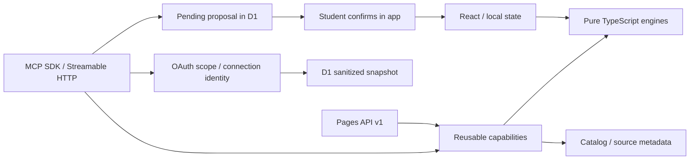

# Kiến trúc triển khai

Giữ Pages Functions và local-first hiện có. Không thêm một server thường trực.

- Calculation, search và validation dùng hàm xác định; AI chỉ diễn giải theo ngữ cảnh có giới hạn.
- Capability không import React, không gọi AI, không biết HTTP transport. Input sai có lỗi có mã.
- API và MCP dùng cùng capability; frontend tiếp tục dùng engine chung và state hiện có.
- Dữ liệu lịch sử/nguồn chưa xác minh phải được thể hiện rõ; có URL không có nghĩa đã kiểm chứng.
- Token quyết định dữ liệu và scope; không dùng student ID do client gửi để chọn hồ sơ.
- Ghi qua MCP chỉ tạo đề xuất chờ xác nhận. App kiểm tra task hiện còn và trạng thái chưa thay đổi trước khi áp.
- Cấu hình plugin/skills nằm trong repo; không chứa token. Browser dùng Chrome/Puppeteer và công cụ browser đã có.

Giới hạn phát hành và kiểm tra thực tế được ghi tại `../reports/final-acceptance.md`; không coi sơ đồ này là bằng chứng production-ready.
