# 1. Product Inventory & Architecture (Kiểm Toán Tổng Quan Sản Phẩm & Kiến Trúc)

> **Ngày kiểm toán:** 2026-10-15
> **Phạm vi:** Toàn bộ mã nguồn monorepo `nguyen-vong-ai` (`src/`, `functions/`, `cms/`, `migrations/`, `scripts/`, `tests/`)
> **Phương pháp:** Kiểm toán dựa trên bằng chứng mã nguồn thực tế (Code-Evidence Audit) — không suy đoán.

---

## 1.1. Tầm Nhìn Sản Phẩm & Triết Lý Thiết Kế

**Nguyện Vọng AI** là ứng dụng web ưu tiên điện thoại (Mobile-First, chuẩn thiết kế `390px`, kiểm định `360px` và `320px`) bằng tiếng Việt trong sáng, đồng hành cùng học sinh THPT Việt Nam (lớp 10, 11, 12 và thí sinh tự do, độ tuổi 15–18) từ lúc định hướng nghề nghiệp cho đến ngày khóa sổ đăng ký nguyện vọng và ôn thi tốt nghiệp THPT.

### Bốn Câu Hỏi Cốt Lõi Của Học Sinh
Mọi màn hình trong ứng dụng được thiết kế xoay quanh 4 câu hỏi cốt lõi ([`README.md`](file:///D:/07-Competitions-Hackathons/mlai/nguyenvongai/README.md#L7-L12), [`.agents/AGENTS.md`](file:///D:/07-Competitions-Hackathons/mlai/nguyenvongai/.agents/AGENTS.md#L33-L34)):
1. **Em đang ở đâu?** — Hồ sơ học lực (6 môn chính + 5 môn tự chọn chương trình GDPT 2018), điểm thi thử theo thời gian, sở thích nghề nghiệp RIASEC, điều kiện học phí & khu vực ([`src/state/types.ts`](file:///D:/07-Competitions-Hackathons/mlai/nguyenvongai/src/state/types.ts#L50-L94)).
2. **Em muốn đi tới đâu?** — Khám phá 3.652 chương trình đào tạo tại 118 trường đại học/học viện trên toàn quốc ([`src/data/du-lieu-that.json`](file:///D:/07-Competitions-Hackathons/mlai/nguyenvongai/src/data/du-lieu-that.json)), xếp danh sách nguyện vọng cân bằng theo 4 nhãn cố định: **Thử sức · Vừa sức · An toàn · Dự phòng** ([`src/engine/phan-tich.ts`](file:///D:/07-Competitions-Hackathons/mlai/nguyenvongai/src/engine/phan-tich.ts#L6-L31)).
3. **Em còn cách bao xa?** — Đo khoảng cách điểm từ tổ hợp hiện tại đến điểm chuẩn tham khảo năm trước của mục tiêu chính, giả lập "Thử tình huống" (cộng điểm từng môn, đổi ngân sách/khu vực) và phân tích môn kéo điểm nhanh nhất theo ma trận **Công sức × Dư địa × Xu hướng thi thử** ([`src/features/muc-tieu/tinh-toan.ts`](file:///D:/07-Competitions-Hackathons/mlai/nguyenvongai/src/features/muc-tieu/tinh-toan.ts)).
4. **Hôm nay em làm gì?** — Sinh danh sách việc cần học theo tuần và giải thuật xếp lịch tự động vào các khoảng trống quanh lịch học chính khóa/học thêm, tự động giảm tải khi học sinh chọn tâm trạng *"Hơi mệt"* ([`src/engine/xep-lich.ts`](file:///D:/07-Competitions-Hackathons/mlai/nguyenvongai/src/engine/xep-lich.ts)).

### Ba Chặng Đồng Hành Theo Độ Tuổi ([`src/state/chang.ts`](file:///D:/07-Competitions-Hackathons/mlai/nguyenvongai/src/state/chang.ts#L1-L78))
Hệ thống tự động suy luận chặng hiện tại qua hàm [`changCuaEm(s)`](file:///D:/07-Competitions-Hackathons/mlai/nguyenvongai/src/state/chang.ts#L31-L39):
- **Chặng 1 — Định hướng (`dinhHuong` - Lớp 10 & 11):** Tập trung khám phá bản thân (trắc nghiệm RIASEC 12 câu), tìm hiểu nhóm ngành và chọn sớm tổ hợp môn tự chọn. Không ép xếp lịch ôn thi căng thẳng.
- **Chặng 2 — Nước rút (`nuocRut` - Lớp 12):** Tập trung khóa mục tiêu chính, cân bằng 4 tầng nguyện vọng (Thử sức / Vừa sức / An toàn / Dự phòng), theo dõi điểm thi thử và lập kế hoạch ôn tập từng ngày.
- **Chặng 3 — Thi lại & Tuyển sinh bổ sung (`thiLai` - Thí sinh tự do):** Tập trung rà soát điểm chuẩn đợt bổ sung, học bạ và tối ưu hóa các môn còn dư địa tăng điểm.

---

## 1.2. Kiến Trúc Tổng Thể Hệ Thống (2-Sub-App Decoupled Architecture)

Hệ thống gồm **2 ứng dụng độc lập** nằm trong cùng một monorepo nhưng đóng gói và triển khai tách biệt trên hạ tầng **Cloudflare Pages + Pages Functions + D1 SQLite + Workers KV + Workers AI + Vectorize**:

```mermaid
flowchart TD
    subgraph ClientTier["Tầng Thiết Bị Người Dùng (Browser / Mobile 390px)"]
        WebApp["Ứng dụng Học sinh & Phụ huynh\n(React 19 + Vite + HashRouter)\n33 Public Routes + 1 Dev Route"]
        LocalStore["LocalStorage ('nvai:v2')\nHồ sơ, Nguyện vọng, Lịch học, Điểm thi"]
        IDBCache["IndexedDB ('nvai-tuyen-sinh-v1')\nSnapshot dữ liệu tuyển sinh đã xuất bản"]
        CMSApp["Ứng dụng Quản trị CMS\n(cms/ - React 19 + Vite + HashRouter)\n6 Route Patterns / 5 Tabs"]
    end

    subgraph EdgePublic["Tầng Edge API Công Khai (functions/)"]
        FnManifest["GET /api/manifest\n& GET /snapshots/:tep"]
        FnTuVan["POST /api/tu-van\n(4-Tier AI Cascade: Cache -> Clef -> Vectorize -> LLM)"]
        FnDongGop["POST /api/bao-sai\nPOST /api/tinh-nguyen\nPOST /api/dang-ky-som"]
    end

    subgraph EdgeCMS["Tầng Edge API Quản Trị (cms/functions/)"]
        FnAuth["POST /api/dang-nhap | dang-xuat | doi-mat-khau\nGET /api/toi (Cookie HMAC-SHA256 'nv_cms')"]
        FnQueue["GET/POST /api/hop-thu\nPOST /api/goi-y-duyet\nPOST /api/xuat-ban-snapshot"]
        FnRBAC["GET/POST/PATCH/DELETE /api/nguoi\nGET/PUT /api/phan-cong\nGET /api/ban-ghi | nhat-ky"]
        FnTele["POST /api/telegram\n(Webhook Bot duyệt nhanh)"]
    end

    subgraph DataTier["Tầng Lưu Trữ & AI (Cloudflare Bindings)"]
        D1[("Cloudflare D1 SQLite\n(7 Migrations: 0001 -> 0007)")]
        KV[("Cloudflare KV\n(KV_CONG_DONG)\nSnapshots, Rate Limit, AI Cache")]
        Vectorize[("Cloudflare Vectorize\n+ Workers AI (BGE-M3 & Llama-3.1-8B Clef)")]
        ExternalLLM["OpenRouter / Anthropic / OpenAI\n(Sinh câu trả lời tư vấn có trích dẫn)"]
    end

    WebApp <--> LocalStore
    WebApp <--> IDBCache
    WebApp -->|"Đồng bộ nền (bo-dong-bo.ts)"| FnManifest
    WebApp -->|"Hỏi đáp có dẫn nguồn"| FnTuVan
    WebApp -->|"Đóng góp cộng đồng"| FnDongGop

    CMSApp -->|"Cookie HttpOnly 'nv_cms'"| FnAuth
    CMSApp --> FnQueue
    CMSApp --> FnRBAC

    FnManifest --> D1
    FnManifest --> KV
    FnTuVan --> KV
    FnTuVan --> Vectorize
    FnTuVan --> ExternalLLM
    FnDongGop --> D1
    FnDongGop --> KV

    FnAuth --> D1
    FnAuth --> KV
    FnQueue --> D1
    FnQueue --> KV
    FnRBAC --> D1
    FnTele --> D1
```

### Bảng Phân Định 2 Ứng Dụng Con (Sub-Apps)

| Tiêu chí | 1. Ứng dụng Học sinh & Phụ huynh (`nguyen-vong-ai`) | 2. Ứng dụng Quản trị & Kiểm duyệt (`nguyenvongai-cms`) |
|---|---|---|
| **Thư mục gốc** | [`/`](file:///D:/07-Competitions-Hackathons/mlai/nguyenvongai/package.json) (`src/`, `functions/`, `public/`) | [`cms/`](file:///D:/07-Competitions-Hackathons/mlai/nguyenvongai/cms/package.json) (`cms/src/`, `cms/functions/`) |
| **Cấu hình Build & Dev** | [`vite.config.ts`](file:///D:/07-Competitions-Hackathons/mlai/nguyenvongai/vite.config.ts) — Cổng `3030`, xuất `dist/` | [`cms/vite.config.ts`](file:///D:/07-Competitions-Hackathons/mlai/nguyenvongai/cms/vite.config.ts) — Cổng `3031`, xuất `cms/dist/` |
| **Cấu hình Cloudflare** | [`wrangler.toml`](file:///D:/07-Competitions-Hackathons/mlai/nguyenvongai/wrangler.toml) (`pages_build_output_dir = "dist"`) | [`cms/wrangler.toml`](file:///D:/07-Competitions-Hackathons/mlai/nguyenvongai/cms/wrangler.toml) (`pages_build_output_dir = "dist"`) |
| **Kiểu định tuyến** | `createHashRouter` ([`src/App.tsx`](file:///D:/07-Competitions-Hackathons/mlai/nguyenvongai/src/App.tsx#L39)) — 33 route công khai + 1 route `/thiet-ke` (chỉ mở khi `import.meta.env.DEV`) | `createHashRouter` ([`cms/src/App.tsx`](file:///D:/07-Competitions-Hackathons/mlai/nguyenvongai/cms/src/App.tsx#L12)) — 6 route pattern qua 5 tab chức năng |
| **Quản lý trạng thái** | Local-first React Context + `localStorage` (`nvai:v2` tại [`src/state/store.tsx`](file:///D:/07-Competitions-Hackathons/mlai/nguyenvongai/src/state/store.tsx#L28)) + IndexedDB (`nvai-tuyen-sinh-v1`) | Stateless REST client [`cms/src/api.ts`](file:///D:/07-Competitions-Hackathons/mlai/nguyenvongai/cms/src/api.ts) (`credentials: "include"`) kết hợp React state theo màn hình |
| **Cơ chế xác thực** | Không yêu cầu đăng nhập (Zero-Auth Local-First). Hỗ trợ xuất/nhập mã hồ sơ Base64 và đồng bộ đa thiết bị tùy chọn. | Cookie phiên `nv_cms` ký HMAC-SHA256 (`HttpOnly; SameSite=Strict; Secure`, TTL 12 giờ) tại [`cms/functions/_thu-vien/xac-thuc.ts`](file:///D:/07-Competitions-Hackathons/mlai/nguyenvongai/cms/functions/_thu-vien/xac-thuc.ts) |

---

## 1.3. Cơ Chế Xác Thực, Phân Quyền (RBAC) & Bảo Mật Phiên

Hệ thống phân tách hoàn toàn luồng sử dụng của học sinh (không rào cản tài khoản) và luồng quản trị dữ liệu quốc gia (bảo mật nhiều lớp, Fail-Closed).

### 1.3.1. Xác Thực & Mật Khẩu CMS ([`cms/functions/_thu-vien/mat-khau.ts`](file:///D:/07-Competitions-Hackathons/mlai/nguyenvongai/cms/functions/_thu-vien/mat-khau.ts) & [`xac-thuc.ts`](file:///D:/07-Competitions-Hackathons/mlai/nguyenvongai/cms/functions/_thu-vien/xac-thuc.ts))
- **Định dạng lưu mật khẩu (`bamMatKhau`):** Chuỗi lưu trong cột `quan_tri.mat_khau` có dạng `sha256$<salt_base64url_16_bytes>$<hash_base64url_32_bytes>`.
  > [!WARNING]
  > **Phát hiện kiểm toán quan trọng:** Hàm [`bamMatKhau`](file:///D:/07-Competitions-Hackathons/mlai/nguyenvongai/cms/functions/_thu-vien/mat-khau.ts#L31-L39) hiện tại chỉ băm **1 vòng `SHA-256(salt || ":" || matKhau)`** qua `crypto.subtle.digest("SHA-256", ...)` chứ **chưa sử dụng thuật toán KDF chậm (`PBKDF2` / `scrypt` / `Argon2`)**. Mặc dù hàm [`kiemTraMatKhau`](file:///D:/07-Competitions-Hackathons/mlai/nguyenvongai/cms/functions/_thu-vien/mat-khau.ts#L41-L55) đã dùng so sánh hằng thời gian (` timing-safe XOR `) để chống timing attack, việc chỉ băm 1 vòng SHA-256 tạo rủi ro dò mật khẩu tốc độ cao nếu cơ sở dữ liệu D1 bị lộ. (Xem chi tiết tại `technical-risks.md`).
- **Tài khoản Khởi tạo (Bootstrap Super Admin):** Trong [`POST /api/dang-nhap`](file:///D:/07-Competitions-Hackathons/mlai/nguyenvongai/cms/functions/api/dang-nhap.ts#L50-L79), nếu email đăng nhập trùng với biến môi trường `SUPER_ADMIN_EMAIL` (mặc định `admin@nguyenvong.ai`) và trong bảng `quan_tri` chưa có `mat_khau`, hệ thống đối chiếu hằng thời gian với `CMS_ADMIN_TOKEN`, sau đó tự động băm và lưu mật khẩu vào D1 để kích hoạt tài khoản `super_admin`.
- **Cookie Phiên (`nv_cms`):** Tạo bởi [`taoCookiePhien`](file:///D:/07-Competitions-Hackathons/mlai/nguyenvongai/cms/functions/_thu-vien/xac-thuc.ts#L34-L42), chứa payload `<email_base64url>.<hetHan_epoch_sec>.<chuKy_HMAC_SHA256>`, thời hạn `43.200 giây` (12 giờ), gắn cờ `HttpOnly; Path=/; SameSite=Strict` (và thêm `Secure` khi chạy trên HTTPS).
- **Chống vét cạn (Rate Limiting):** Tại [`cms/functions/api/dang-nhap.ts`](file:///D:/07-Competitions-Hackathons/mlai/nguyenvongai/cms/functions/api/dang-nhap.ts#L22-L29), khóa KV `login:<ip>:<email>` giới hạn tối đa **5 lần sai trong 15 phút** (`900 giây`), trả mã HTTP `429`.

### 1.3.2. Ma Trận Phân Quyền 4 Vai Trò (4-Tier RBAC)
Được định nghĩa tại [`cms/functions/_thu-vien/quyen.ts`](file:///D:/07-Competitions-Hackathons/mlai/nguyenvongai/cms/functions/_thu-vien/quyen.ts#L1-L162) và thực thi trực tiếp trên mọi endpoint API:

| Vai trò (`VaiTro`) | Nhãn hiển thị | Quyền đọc Hộp thư (`hop-thu`) | Quyền Duyệt / Bác bỏ (`DUYET` / `TU_CHOI`) | Quyền Cấp quyền CTV (`CAP_QUYEN`) | Quyền Xuất bản Snapshot (`xuat-ban-snapshot`) | Quyền Quản lý Thành viên & Phân công (`nguoi`, `phan-cong`) |
|---|---|---|---|---|---|---|
| `super_admin` | **Tổng quản trị** | Toàn bộ 3 luồng (`bao_sai`, `tinh_nguyen`, `dang_ky_som`) trên mọi trường | Duyệt mọi mục trên toàn quốc | Có | Có | Toàn quyền tạo/sửa/khóa/xóa mọi cấp (`super_admin`, `admin`, `mod`, `ctv`) |
| `admin` | **Quản trị viên** | Toàn bộ 3 luồng trên mọi trường | Duyệt mọi mục trên toàn quốc | Có | Có | Tạo/sửa/khóa/xóa `mod` và `ctv` (không được sửa/xóa `super_admin` hoặc `admin` khác — [`nguoi.ts:95`](file:///D:/07-Competitions-Hackathons/mlai/nguyenvongai/cms/functions/api/nguoi.ts#L95)) |
| `mod` | **Điều hành viên** | Chỉ xem `bao_sai` của các trường được phân công + toàn bộ `tinh_nguyen` | Duyệt `bao_sai` (trong phạm vi trường phụ trách) + `tinh_nguyen` | Có (duyệt đơn tình nguyện thành `ctv`) | **Không** (`403`) | Chỉ xem danh sách CTV/Mod và phân công trường cho `ctv` ([`phan-cong.ts:44`](file:///D:/07-Competitions-Hackathons/mlai/nguyenvongai/cms/functions/api/phan-cong.ts#L44)) |
| `ctv` | **Cộng tác viên** | Chỉ xem `bao_sai` của đúng các mã trường (`ma_truong`) được gán trong bảng `phan_cong_truong` | Chỉ duyệt/bác bỏ `bao_sai` thuộc trường mình phụ trách (`coQuyenTruong`) | **Không** (`403`) | **Không** (`403`) | **Không** (`403`) |

---

## 1.4. Cơ Sở Dữ Liệu D1, Pipeline Dữ Liệu Quốc Gia & Đồng Bộ Offline-First

### 1.4.1. Lược Đồ Cơ Sở Dữ Liệu Cloudflare D1 (7 Migrations)
Toàn bộ lược đồ SQLite D1 nằm trong thư mục [`migrations/`](file:///D:/07-Competitions-Hackathons/mlai/nguyenvongai/migrations/):

| Thứ tự | File Migration | Các bảng & chỉ mục khởi tạo / nâng cấp | Mục đích nghiệp vụ |
|---|---|---|---|
| `0001` | [`0001_khoi_tao.sql`](file:///D:/07-Competitions-Hackathons/mlai/nguyenvongai/migrations/0001_khoi_tao.sql) | `phien_ban_du_lieu`, `truong`, `nganh_tuyen_sinh`, `bao_sai`, `tinh_nguyen_vien`, `nhat_ky_duyet` | Khởi tạo kho dữ liệu tuyển sinh chuẩn hóa, hàng đợi báo sai, đăng ký tình nguyện và nhật ký kiểm duyệt |
| `0002` | [`0002_dang_ky_som.sql`](file:///D:/07-Competitions-Hackathons/mlai/nguyenvongai/migrations/0002_dang_ky_som.sql) | `dang_ky_som` (`id`, `ho_ten`, `vai_tro`, `lop`, `tinh`, `lien_he`, `truong_quan_tam`, `ghi_chu`, `trang_thai`) | Thu thập danh sách học sinh/phụ huynh/giáo viên đăng ký trải nghiệm sớm và nhận thông báo |
| `0003` | [`0003_ai_rag.sql`](file:///D:/07-Competitions-Hackathons/mlai/nguyenvongai/migrations/0003_ai_rag.sql) | `tai_lieu_nguon`, `doan_van_ai`, `lich_su_tu_van`, `goi_y_ai_duyet` | Lưu trữ văn bản quy chế Bộ GD&ĐT / đề án tuyển sinh băm nhỏ (`chunk`), lịch sử tư vấn AI ẩn danh và gợi ý duyệt tự động cho CMS |
| `0004` | [`0004_phan_quyen.sql`](file:///D:/07-Competitions-Hackathons/mlai/nguyenvongai/migrations/0004_phan_quyen.sql) | `quan_tri`, `phan_cong_truong`, `lich_su_quyen` | Hệ thống tài khoản quản trị 4 cấp, phân quyền theo phạm vi trường đại học (`ma_truong`) và lưu vết cấp/thu hồi quyền |
| `0005` | [`0005_mat_khau.sql`](file:///D:/07-Competitions-Hackathons/mlai/nguyenvongai/migrations/0005_mat_khau.sql) | `ALTER TABLE quan_tri ADD COLUMN mat_khau TEXT`, `buoc_doi_mk INTEGER` | Bổ sung xác thực mật khẩu độc lập cho từng thành viên và cờ bắt buộc đổi mật khẩu tạm lần đầu đăng nhập |
| `0006` | [`0006_sua_unique_nganh.sql`](file:///D:/07-Competitions-Hackathons/mlai/nguyenvongai/migrations/0006_sua_unique_nganh.sql) | `idx_nganh_unique (ma_truong, ma_nganh, ma_to_hop, nam_diem, phuong_thuc)` | Sửa ràng buộc duy nhất của bảng `nganh_tuyen_sinh` để một ngành có thể xét tuyển nhiều tổ hợp (`A00`, `A01`, `D01`...) |
| `0007` | [`0007_seed_du_lieu_quoc_gia.sql`](file:///D:/07-Competitions-Hackathons/mlai/nguyenvongai/migrations/0007_seed_du_lieu_quoc_gia.sql) | Seed **118 dòng `truong`** + **3.652 dòng `nganh_tuyen_sinh`** + `phien_ban_du_lieu` (`v2026.04.14-national`) | Nạp toàn bộ dữ liệu tuyển sinh quốc gia ban đầu vào D1 |

### 1.4.2. Cơ Chế Đồng Bộ Snapshot Về Trình Duyệt (Client-Side IndexedDB Merge)
Ứng dụng học sinh hoạt động **100% không cần mạng** nhờ gói dữ liệu tĩnh [`src/data/du-lieu-that.json`](file:///D:/07-Competitions-Hackathons/mlai/nguyenvongai/src/data/du-lieu-that.json) (được nạp qua [`src/data/lua-chon-mau.ts`](file:///D:/07-Competitions-Hackathons/mlai/nguyenvongai/src/data/lua-chon-mau.ts)). Khi có kết nối mạng:
1. [`bo-dong-bo.ts`](file:///D:/07-Competitions-Hackathons/mlai/nguyenvongai/src/engine/du-lieu-tuyen-sinh/bo-dong-bo.ts#L57-L115) chạy ngầm sau khi trang chính render xong (`2.000ms`), gọi `GET /api/manifest` (tối đa 6 giờ/lần theo khóa `nvai:ts-sync-meta`).
2. Nếu `manifest.phienBan` mới hơn bản lưu trong IndexedDB (`nvai-tuyen-sinh-v1`), trình duyệt tải gói `/snapshots/<tep>.json` và kiểm tra toàn vẹn mã băm **SHA-256** bằng Web Crypto API ([`kiemTraSha256`](file:///D:/07-Competitions-Hackathons/mlai/nguyenvongai/src/engine/du-lieu-tuyen-sinh/bo-dong-bo.ts#L28-L37)).
3. Hàm [`hopNhatLuaChon`](file:///D:/07-Competitions-Hackathons/mlai/nguyenvongai/src/data/lua-chon-mau.ts#L101-L128) hợp nhất bản ghi mới từ IndexedDB đè lên `DANH_SACH_GOC` mà **không bao giờ xóa trắng** danh mục tĩnh nếu snapshot từ máy chủ chỉ chứa một phần bản ghi (`partial snapshot protection`).

---

## 1.5. Kiến Trúc Tư Vấn AI 4 Tầng (4-Tier AI RAG + Clef Pipeline)

Endpoint [`POST /api/tu-van`](file:///D:/07-Competitions-Hackathons/mlai/nguyenvongai/functions/api/tu-van.ts) thực thi quy trình 4 tầng trong [`functions/_thu-vien/ai/bac-thang.ts`](file:///D:/07-Competitions-Hackathons/mlai/nguyenvongai/functions/_thu-vien/ai/bac-thang.ts):

1. **Tầng 0 — Bộ nhớ đệm KV (`cache.ts`):** Băm câu hỏi đã chuẩn hóa + hồ sơ rút gọn (`maToHop`, `tongDiem`, `khuVuc`, `nganSach`, `nhomNganh`) thành khóa KV. Nếu trúng cache (`tuCache: true`), phản hồi ngay trong `< 30ms` mà không tốn token LLM.
2. **Tầng 1 — Bộ lọc Clef (`clef.ts`):** Dùng mô hình `@cf/meta/llama-3.1-8b-instruct-fast` trên Workers AI (hoặc heuristic từ khóa tiếng Việt khi không có binding `AI`) để phân loại ý định câu hỏi (`loai: diem_chuan | hoc_phi | to_hop | quy_che | so_sanh | goi_y | ngoai_pham_vi`) và rút trích danh sách mã trường/ngành liên quan. Nếu `ngoai_pham_vi`, từ chối lịch sự ngay lập tức.
3. **Tầng 2 — Truy xuất Vectorize & D1 (`chi-muc.ts` + `nhung.ts`):** Nhúng câu hỏi bằng mô hình đa ngữ `@cf/baai/bge-m3` (`1024 chiều`), truy vấn top đoạn văn từ `VECTORIZE` kết hợp truy vấn trực tiếp các dòng `nganh_tuyen_sinh` và `tai_lieu_nguon` từ D1.
4. **Tầng 3 — Sinh văn bản & Kiểm duyệt Trích dẫn (`sinh-van-ban.ts`):** Gọi LLM qua `OPENROUTER_API_KEY` (mặc định `google/gemini-2.5-flash-lite`), `ANTHROPIC_API_KEY` (`claude-haiku-4-5-20251001`) hoặc `OPENAI_API_KEY` (`gpt-4o-mini`). Sau khi LLM trả kết quả JSON, hàm [`locNguon`](file:///D:/07-Competitions-Hackathons/mlai/nguyenvongai/functions/_thu-vien/ai/sinh-van-ban.ts#L156-L176) đối chiếu từng nguồn trích dẫn với tập văn bản gốc (`hopLe`) để **loại bỏ hoàn toàn URL/nguồn do AI tự bịa (hallucinated citations)**.
5. **Tầng Dự phòng Client-Side (`traLoiTuDong` tại [`src/features/tu-van/lay-du-lieu.ts`](file:///D:/07-Competitions-Hackathons/mlai/nguyenvongai/src/features/tu-van/lay-du-lieu.ts#L106-L195)):** Nếu máy chủ trả `503 CHUA_CAU_HINH` hoặc mất mạng, trình duyệt tự động tính toán câu trả lời cục bộ từ dữ liệu tĩnh và gắn nhãn minh bạch *"Trả lời tự động trên thiết bị"*.

---

## 1.6. Kiểm Toán 14 Feature Slices & Các Hệ Thống Dùng Chung

Toàn bộ mã nguồn giao diện học sinh trong [`src/features/`](file:///D:/07-Competitions-Hackathons/mlai/nguyenvongai/src/features/) được chia thành **14 thư mục slice độc lập**:

| STT | Slice (`src/features/<slice>`) | Số Route | Các file chính | Vai trò trong hành trình sản phẩm |
|---|---|---|---|---|
| 1 | [`landing-page`](file:///D:/07-Competitions-Hackathons/mlai/nguyenvongai/src/features/landing-page/routes.tsx) | 1 | `index.tsx`, `hero- showcase.tsx`, `app-showcase.tsx`, `footer-cta.tsx` | Trang giới thiệu sản phẩm (`/gioi-thieu` — được khóa bảo vệ theo tag `landing-approved-2026-10-07`) |
| 2 | [`khoi-dau`](file:///D:/07-Competitions-Hackathons/mlai/nguyenvongai/src/features/khoi-dau/routes.tsx) | 3 | `chao-mung.tsx`, `bat-dau.tsx`, `san-sang.tsx`, `tinh-toan.ts` | Onboarding 3 bước: Chọn lớp & tâm trạng -> Nhập điểm (6 môn chính + 5 môn GDPT 2018) -> Chọn sở thích, ngân sách, khu vực -> Gợi ý 3 trường đầu tiên |
| 3 | [`hanh-trinh`](file:///D:/07-Competitions-Hackathons/mlai/nguyenvongai/src/features/hanh-trinh/routes.tsx) | 4 | `hom-nay.tsx`, `lo-trinh.tsx`, `ho-so.tsx`, `ve-du-lieu.tsx` | Tab **Hôm nay** (`/hom-nay`), bản đồ Lộ trình 3 năm THPT (`/lo-trinh`), quản lý Hồ sơ + Sao lưu mã Base64 (`/ho-so`), minh bạch nguồn dữ liệu (`/ve-du-lieu`) |
| 4 | [`huong-nghiep`](file:///D:/07-Competitions-Hackathons/mlai/nguyenvongai/src/features/huong-nghiep/routes.tsx) | 2 | `trac-nghiem.tsx`, `ket-qua-nghe.tsx`, `cau-hoi-riasec.ts` | Trắc nghiệm sở thích nghề nghiệp Holland RIASEC 12 câu (`/huong-nghiep`) và trang phân tích top 2 nhóm tính cách + gợi ý ngành (`/huong-nghiep/ket-qua`) |
| 5 | [`kham-pha`](file:///D:/07-Competitions-Hackathons/mlai/nguyenvongai/src/features/kham-pha/routes.tsx) | 4 | `kham-pha.tsx`, `bo-loc.tsx`, `so-sanh.tsx`, `chi-tiet.tsx`, `tinh-toan.ts` | Tab **Khám phá** (`/kham-pha`), bộ lọc đa tiêu chí (`/kham-pha/bo-loc`), đặt 3 trường cạnh nhau (`/kham-pha/so-sanh`), chi tiết ngành + tính điểm quy đổi/ưu tiên (`/kham-pha/truong/:id`) |
| 6 | [`nguyen-vong`](file:///D:/07-Competitions-Hackathons/mlai/nguyenvongai/src/features/nguyen-vong/routes.tsx) | 3 | `danh-sach.tsx`, `kiem-tra.tsx`, `sap-xep.tsx`, `tinh-toan.ts` | Tab **Nguyện vọng** (`/nguyen-vong`), kiểm tra độ cân bằng 4 tầng (`/nguyen-vong/kiem-tra`) và gợi ý thứ tự đặt nguyện vọng (`/nguyen-vong/sap-xep`) |
| 7 | [`thu-tinh-huong`](file:///D:/07-Competitions-Hackathons/mlai/nguyenvongai/src/features/thu-tinh-huong/routes.tsx) | 4 | `thu-tinh-huong.tsx`, `ket-qua-tinh-huong.tsx`, `diem-thi-thu.tsx`, `ket-qua-diem-thi.tsx` | Giả lập thay đổi điểm/học phí/khu vực (`/thu-tinh-huong` & `/ket-qua`) và cập nhật Điểm thi thử kèm so sánh ảnh chụp trước/sau (`/diem-thi-thu` & `/ket-qua`) |
| 8 | [`muc-tieu`](file:///D:/07-Competitions-Hackathons/mlai/nguyenvongai/src/features/muc-tieu/routes.tsx) | 2 | `muc-tieu.tsx`, `mon-keo-diem.tsx`, `sua-muc-tieu.tsx`, `tinh-toan.ts` | Quản lý Mục tiêu chính (`/ke-hoach/muc-tieu`), đếm ngược ngày thi và phân tích môn kéo điểm nhanh nhất (`/ke-hoach/muc-tieu/mon`) |
| 9 | [`ke-hoach`](file:///D:/07-Competitions-Hackathons/mlai/nguyenvongai/src/features/ke-hoach/routes.tsx) | 3 | `chuyen-huong.tsx`, `ke-hoach-tuan.tsx`, `chi-tiet-viec.tsx`, `che-do-viec.tsx`, `che-do-lich.tsx`, `che-do-chien-luoc.tsx` | Tab **Kế hoạch** (`/ke-hoach` điều hướng thông minh), danh sách việc/lịch/chiến lược tuần (`/ke-hoach/tuan`) và chi tiết từng buổi học (`/ke-hoach/viec/:id`) |
| 10 | [`tu-hoc`](file:///D:/07-Competitions-Hackathons/mlai/nguyenvongai/src/features/tu-hoc/routes.tsx) | 4 | `tien-do.tsx`, `lich-hoc.tsx`, `cai-dat-tu-hoc.tsx`, `nhac-nho-trang.tsx`, `nhac-nho-nen.tsx` | Theo dõi Tiến độ & Cảnh báo lệch lịch (`/ke-hoach/tien-do`), quản lý Tiết cố định (`/cai-dat/lich-hoc`), Khung giờ tự học (`/cai-dat/tu-hoc`), Nhắc nhở Web Notification (`/cai-dat/nhac-nho`) |
| 11 | [`tu-van`](file:///D:/07-Competitions-Hackathons/mlai/nguyenvongai/src/features/tu-van/routes.tsx) | 1 | `tu-van.tsx`, `lay-du-lieu.ts` | Trợ lý hỏi đáp tuyển sinh AI có dẫn nguồn trang/đoạn đề án (`/tu-van`) + nút nổi `NutTuVan` nhúng ở các trang chính |
| 12 | [`dong-hanh`](file:///D:/07-Competitions-Hackathons/mlai/nguyenvongai/src/features/dong-hanh/routes.tsx) | 2 | `phu-huynh.tsx`, `giao-vien.tsx` | Góc Phụ huynh đồng hành tài chính & tâm lý (`/phu-huynh`, hỗ trợ `?ma=` xem hồ sơ con) và Góc Giáo viên chủ nhiệm phân tích danh sách mã học sinh cả lớp (`/giao-vien`) |
| 13 | [`dong-gop`](file:///D:/07-Competitions-Hackathons/mlai/nguyenvongai/src/features/dong-gop/routes.tsx) | 3 | `bao-sai.tsx`, `tinh-nguyen.tsx`, `dang-ky-som.tsx` | Biểu mẫu cộng đồng: Báo dữ liệu chưa khớp (`/bao-sai`), Đăng ký tình nguyện viên xác minh đề án (`/tinh-nguyen`), Đăng ký trải nghiệm sớm (`/dang-ky-som`) |
| 14 | [`thiet-ke`](file:///D:/07-Competitions-Hackathons/mlai/nguyenvongai/src/features/thiet-ke/trang-thiet-ke.tsx) | 1 (Dev) | `trang-thiet-ke.tsx` | Phòng trưng bày toàn bộ Design System, bảng màu và UI Component (`/thiet-ke`, chỉ bật khi `import.meta.env.DEV`) |

---

## 1.7. Hệ Thống Kiểm Tra Tự Động (Automated Quality Gate)

Dự án duy trì bộ cổng kiểm tra tự động nghiêm ngặt chạy qua `npm test` và `npm run kiem-tra`:
- **Cổng đồng nhất mã nguồn ([`tests/kiem-tra-route.ts`](file:///D:/07-Competitions-Hackathons/mlai/nguyenvongai/tests/kiem-tra-route.ts)):**
  1. Kiểm tra đối xứng 100% giữa khóa `MAU`, hàm tạo đường dẫn `DUONG_DAN` trong [`src/duong-dan.ts`](file:///D:/07-Competitions-Hackathons/mlai/nguyenvongai/src/duong-dan.ts) và các route đăng ký trong `src/features/*/routes.tsx`.
  2. Cấm viết đường dẫn cứng (`to="/..."` hoặc `navigate("/...")`) ngoài `duong-dan.ts`.
  3. Cấm viết mã màu hex cứng (`#xxxxxx`) hoặc `rgb()` trong `src/components/` và `src/features/`.
  4. Cấm sử dụng các thuật ngữ tiếng Anh/biệt ngữ kỹ thuật trong giao diện học sinh (`dashboard`, `kịch bản`, `giả lập`, `tác động`, `rủi ro`, `chống trượt`, `tối ưu`, `CTA`, `widget`, `onboarding`, `profile`).
- **Bộ Unit & Integration Tests (`tests/*.test.ts`):**
  - [`tests/xep-lich.test.ts`](file:///D:/07-Competitions-Hackathons/mlai/nguyenvongai/tests/xep-lich.test.ts): Kiểm thử giải thuật xếp lịch tự động, tránh trùng tiết cố định và giờ ăn nghỉ.
  - [`tests/quy-doi-diem.test.ts`](file:///D:/07-Competitions-Hackathons/mlai/nguyenvongai/tests/quy-doi-diem.test.ts): Kiểm thử công thức quy đổi điểm khu vực/đối tượng ưu tiên (giảm dần từ mốc 22.5 điểm theo quy chế Bộ GD&ĐT) và quy đổi IELTS/ĐGNL.
  - [`tests/bo-dong-bo-rong.test.ts`](file:///D:/07-Competitions-Hackathons/mlai/nguyenvongai/tests/bo-dong-bo-rong.test.ts): Đảm bảo snapshot rỗng hoặc một phần không bao giờ làm mất dữ liệu gốc của học sinh.
  - [`tests/ai-clef.test.ts`](file:///D:/07-Competitions-Hackathons/mlai/nguyenvongai/tests/ai-clef.test.ts): Kiểm thử bộ phân loại câu hỏi AI Clef và lọc trích dẫn.
