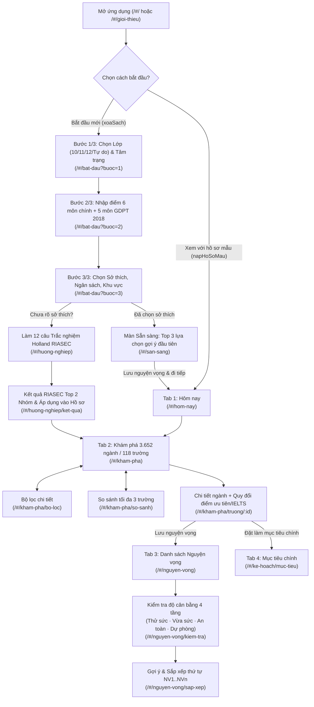
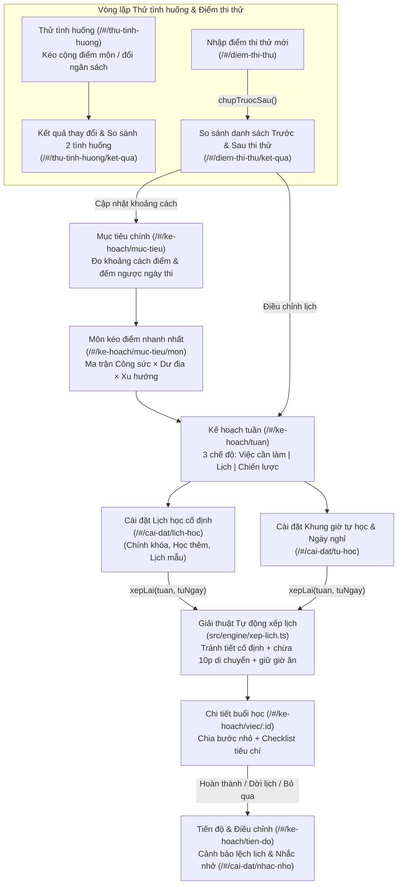
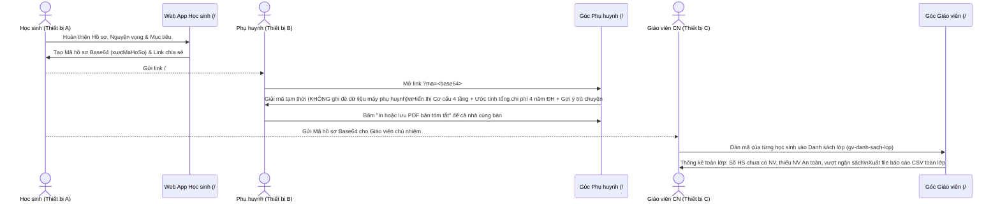
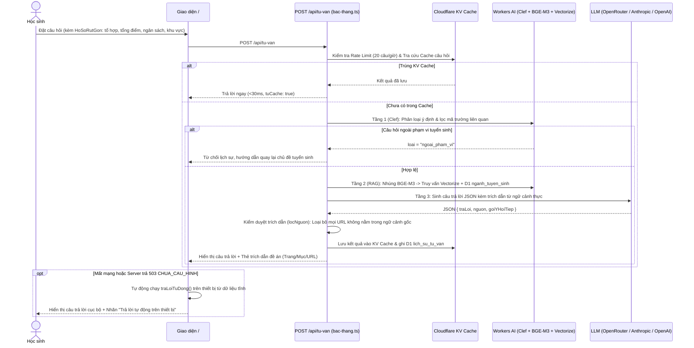
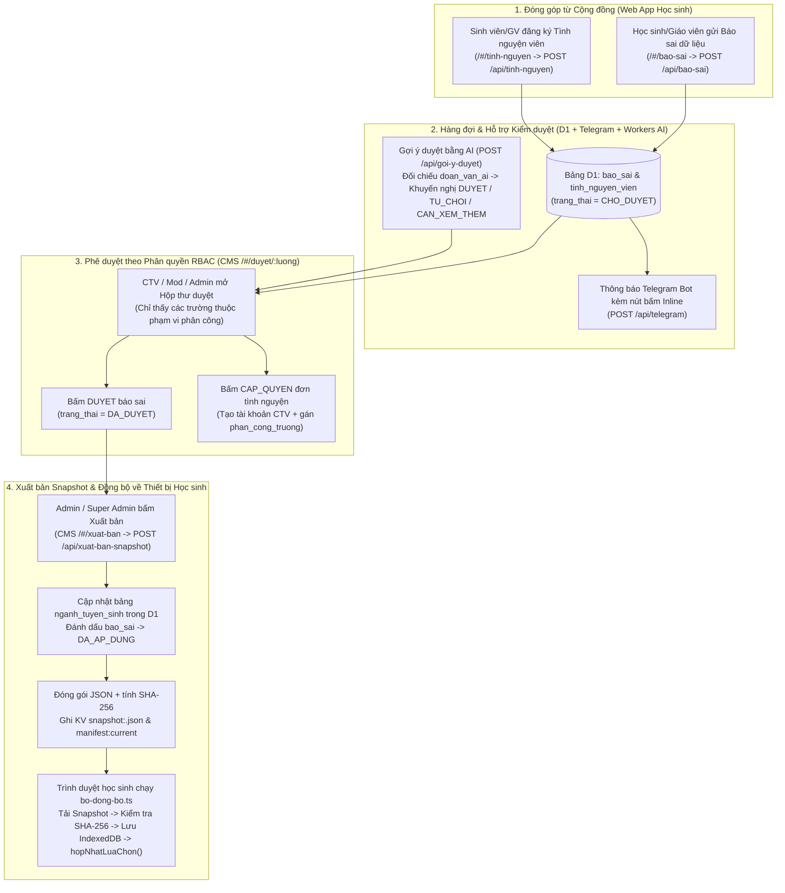

# 4. End-to-End User Journeys & Flow Analysis (Kiểm Toán Luồng Hành Trình Người Dùng)

> **Ngày kiểm toán:** 2026-10-15
> **Phạm vi:** 5 hành trình người dùng cốt lõi xuyên suốt từ Học sinh (Lớp 10–12 & Thí sinh tự do), Phụ huynh, Giáo viên chủ nhiệm cho đến Cộng tác viên & Quản trị viên CMS.

---

## 4.1. Hành Trình 1: Học Sinh Khởi Đầu, Định Hướng RIASEC & Xây Dựng Danh Sách Nguyện Vọng Cân Bằng

### Sơ Đồ Luồng Tương Tác (Mermaid Flowchart)

### Phân Tích Chi Tiết Từng Bước & Điểm Đứt Gãy (Friction Analysis)
1. **Phân tách Hồ sơ mẫu và Hồ sơ cá nhân (`/` -> `/bat-dau`):**
   - Trong [`chao-mung.tsx:31`](file:///D:/07-Competitions-Hackathons/mlai/nguyenvongai/src/features/khoi-dau/chao-mung.tsx#L31), nút **Bắt đầu** gọi `xoaSach()` trước khi chuyển sang `/bat-dau`, đảm bảo học sinh từng bấm xem thử hồ sơ mẫu trước đó không bị dính điểm số hay nguyện vọng demo vào hồ sơ thật của mình.
2. **Nhánh rẽ Trắc nghiệm Hướng nghiệp RIASEC (`/bat-dau?buoc=3` -> `/huong-nghiep`):**
   - Học sinh lớp 10–11 chưa biết chọn nhóm ngành nào ở Bước 3 có thể bấm thẳng vào thẻ **"Chưa rõ mình hợp ngành nào? Làm 12 câu trắc nghiệm nhanh"**.
   - **Điểm nghẽn UX #1 (Mất mạch Onboarding khi rẽ sang RIASEC):** Khi hoàn thành 12 câu tại [`ket-qua-nghe.tsx:41-47`](file:///D:/07-Competitions-Hackathons/mlai/nguyenvongai/src/features/huong-nghiep/ket-qua-nghe.tsx#L41-L47), nút **Áp dụng vào hồ sơ & Khám phá trường** điều hướng thẳng tới `/kham-pha` mà **bỏ qua** phần còn lại của Bước 3 (chọn Học phí tối đa `nganSachTrieu` và Khu vực ưu tiên `khuVuc`, khiến 2 trường này giữ nguyên giá trị mặc định `30 triệu/năm` và `Đông Nam Bộ`).
3. **Điểm nghẽn UX #2 (Đứt gãy các tổ hợp môn mới GDPT 2018 khi Đặt mục tiêu):**
   - Ở `/bat-dau?buoc=2`, học sinh ban Xã hội hoặc chương trình mới nhập điểm Ngữ văn, Lịch sử, Địa lý (`C00`) hoặc Toán, Anh, Tin học (`IT`). Khi vào `/kham-pha`, các ngành xét `C00`, `D14`, `D15` vẫn được tính điểm phù hợp bình thường nhờ `TONG_TO_HOP_MO_RONG`.
   - Tuy nhiên, khi học sinh bấm vào trang chi tiết ngành đó (`/kham-pha/truong/:id`) để bấm **Đặt làm mục tiêu chính**, hàm [`coTheDatMucTieu(lc)`](file:///D:/07-Competitions-Hackathons/mlai/nguyenvongai/src/state/chon.ts#L93-L96) chỉ kiểm tra 4 mã `A00, A01, D01, B00`. Nếu ngành chỉ xét `C00`, nút đặt mục tiêu bị khóa cứng với lý do *"chưa hỗ trợ tổ hợp của ngành này"*.

---

## 4.2. Hành Trình 2: Học Sinh Giả Lập Tình Huống, Nhập Điểm Thi Thử & Tự Động Xếp Lịch Học Tuần

### Sơ Đồ Luồng Tương Tác (Mermaid Flowchart)

### Phân Tích Chi Tiết & Điểm Sáng / Điểm Nghẽn
1. **Điểm sáng thiết kế — Chụp ảnh Trước/Sau khi nhập điểm thi thử (`diem-thi-thu.tsx` -> `ket-qua-diem-thi.tsx`):**
   - Trước khi ghi điểm thi thử mới vào `store`, hàm [`chupTruocSau`](file:///D:/07-Competitions-Hackathons/mlai/nguyenvongai/src/features/thu-tinh-huong/tinh-toan.ts#L198-L246) lưu lại toàn bộ nhãn nguyện vọng (`Thử sức / Vừa sức / An toàn / Dự phòng`) và điểm phù hợp của từng trường vào `localStorage` (`diem-thi-thu-truoc-sau`). Nhờ đó, màn hình kết quả chỉ rõ ngành nào vừa thăng hạng từ *Thử sức* lên *Vừa sức*, hoặc cảnh báo nếu danh sách mất đi lựa chọn *An toàn*.
2. **Điểm sáng thuật toán — Xếp lịch thông minh có đệm di chuyển (`src/engine/xep-lich.ts`):**
   - Giải thuật tự động chừa `10 phút` đệm trước và sau mỗi tiết cố định để học sinh di chuyển, luôn khóa cứng khung giờ ăn trưa (`11:45–13:00`) và ăn tối (`18:00–19:00`), đồng thời tự động cắt giảm trần giờ học trong ngày khi học sinh chọn tâm trạng *"Hơi mệt"* ở trang Hôm nay.
3. **Điểm nghẽn UX #3 (Thiếu 5 môn tự chọn ở màn Nhập điểm thi thử):**
   - Trong [`diem-thi-thu.tsx:19-26`](file:///D:/07-Competitions-Hackathons/mlai/nguyenvongai/src/features/thu-tinh-huong/diem-thi-thu.tsx#L19-L26), mảng `O_MON` chỉ hiển thị 6 ô (`toan, nguVan, tiengAnh, vatLy, hoaHoc, sinh`). Học sinh thi thử các môn Lịch sử, Địa lý, GDKT&PL, Tin học, Công nghệ không thể ghi nhận lịch sử thi thử tại màn hình này mà phải quay về `/ho-so` sửa điểm gốc.

---

## 4.3. Hành Trình 3: Phụ Huynh & Giáo Viên Chủ Nhiệm Đồng Hành Cùng Học Sinh

### Sơ Đồ Tương Tác Liên Vai Trò (Sequence Diagram)

### Đánh Giá Thiết Kế Luồng Đồng Hành
- **Không cần máy chủ trung gian hay đăng ký tài khoản phức tạp:** Toàn bộ trạng thái hồ sơ được nén thành chuỗi Base64 URL-safe có tiền tố `NVAI1:` ([`src/state/store.tsx:207-235`](file:///D:/07-Competitions-Hackathons/mlai/nguyenvongai/src/state/store.tsx#L207-L235)).
- **Chế độ Xem An Toàn (`Safe Read-Only Mode`) trên máy Phụ huynh:** Trong [`phu-huynh.tsx:52-68`](file:///D:/07-Competitions-Hackathons/mlai/nguyenvongai/src/features/dong-hanh/phu-huynh.tsx#L52-L68), khi phát hiện tham số `?ma=` trên URL, trang đọc dữ liệu vào biến cục bộ `hoSoXem` chứ không gọi `nhapMaHoSo` ghi đè vào `localStorage` của máy đang mở.

---

## 4.4. Hành Trình 4: Trợ Lý Tư Vấn AI 4 Tầng & Cơ Chế Chống Bịa Nguồn

---

## 4.5. Hành Trình 5: Đóng Góp Cộng Đồng, Kiểm Duyệt CMS & Xuất Bản Snapshot Quốc Gia

### Sơ Đồ Luồng Quản Trị Dữ Liệu (Mermaid Flowchart)

### Phát Hiện Đứt Gãy Luồng Nghiệp Vụ CMS (Critical Workflow Bug)
> [!CAUTION]
> **Đứt gãy luồng Thăng cấp Tình nguyện viên thành CTV (`CAP_QUYEN`):**
> - Khi một `mod` hoặc `admin` bấm nút **"Duyệt & Cấp quyền CTV"** tại [`cms/src/phe-duyet/danh-sach-duyet.tsx:221`](file:///D:/07-Competitions-Hackathons/mlai/nguyenvongai/cms/src/phe-duyet/danh-sach-duyet.tsx#L221), endpoint [`POST /api/hop-thu`](file:///D:/07-Competitions-Hackathons/mlai/nguyenvongai/cms/functions/api/hop-thu.ts#L103-L115) thực thi câu lệnh:
>   `INSERT INTO quan_tri (email, ho_ten, vai_tro, ...) VALUES (?, ?, 'ctv', ...)` mà **không truyền cột `mat_khau`** (dẫn tới `mat_khau = NULL`) và cũng không trả về mật khẩu tạm trên giao diện.
> - Hệ quả: Tình nguyện viên vừa được cấp quyền CTV khi vào trang đăng nhập CMS sẽ bị chặn bởi lỗi `403 Tài khoản chưa được cấp mật khẩu` ([`dang-nhap.ts:81`](file:///D:/07-Competitions-Hackathons/mlai/nguyenvongai/cms/functions/api/dang-nhap.ts#L81)), buộc `admin` phải mở tiếp tab **Hệ thống -> Quản lý thành viên -> Đặt lại mật khẩu** mới lấy được mật khẩu tạm gửi cho CTV. (Xem hướng khắc phục tại `technical-risks.md`).
