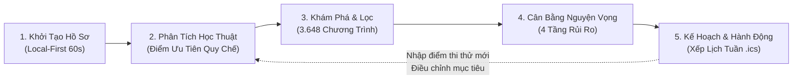

<style>
  @page {
    size: A4 portrait;
    margin: 18mm 18mm 20mm 18mm;
  }
  .page-break {
    page-break-after: always;
    break-after: page;
  }
</style>

<!-- ============================================================================== -->
<!-- TRANG 01 / 20: TRANG BÌA CHÍNH THỨC (COVER PAGE) -->
<!-- ============================================================================== -->

<div align="center">

# BÁO CÁO ĐỀ ÁN KỸ THUẬT & SẢN PHẨM
## NGUYỆN VỌNG AI
### Hệ thống Hỗ trợ Ra Quyết định Tuyển sinh & Lộ trình Học tập Toàn diện Dành cho Học sinh THPT Việt Nam

---

**Cuộc thi**: Decision Intelligence Challenge 2026  
**Chủ đề thi**: Bài toán số 6 — *Chọn trường hoặc chương trình học*  
**Đơn vị phát triển**: Nhóm Dự án Nguyện Vọng AI  
**Địa chỉ Web thực nghiệm (Production)**: [https://nguyenvongai.pages.dev/](https://nguyenvongai.pages.dev/)  
**Mã nguồn kiểm chứng**: Nhánh `feat/agent-native-mcp` | Commit Hash: `dae3c8c`  
**Durable Checkpoint**: `checkpoint-antigravity-takeover-2026-10-16`  
**Ngày phát hành tài liệu**: Ngày 16 tháng 10 năm 2026  

---

### THÔNG TIN TỔNG QUAN HỒ SƠ

| Thuộc tính | Giá trị kiểm chứng trong hệ thống |
|:---|:---|
| **Mô hình kiến trúc** | Local-First SPA + Edge Serverless APIs + MCP Streamable HTTP |
| **Quy mô danh mục** | 3.648 chương trình đào tạo của 118 trường đại học trên cả nước |
| **Công nghệ nền tảng** | React 19, TypeScript 7, Cloudflare Pages/Functions, Cloudflare D1, KV, Vectorize |
| **Giao thức Agent** | Model Context Protocol (@modelcontextprotocol/sdk v1.32.1 - 18 tools) |
| **Độ bao phủ kiểm thử** | 100% đạt trên 60+ Test Suites, 144 Responsive Viewport Checks |
| **Tình trạng nghiệm thu** | Sẵn sàng bảo vệ kỹ thuật trước Hội đồng Giám khảo |

</div>

> **Tuyên ngôn sản phẩm**: *Nguyện Vọng AI không phải là một chatbot trả lời tự do dễ bịa số liệu, cũng không phải một bảng tra cứu điểm tĩnh. Đây là một Decision Intelligence Engine tất định, kết nối từ hồ sơ năng lực thực tế, điều kiện gia đình đến chiến lược phân tầng nguyện vọng và lịch học hành động từng tuần của học sinh.*

<div class="page-break"></div>

<!-- ============================================================================== -->
<!-- TRANG 02 / 20: TÓM TẮT ĐIỀU HÀNH & MA TRẬN GIÁ TRỊ DỰ ÁN -->
<!-- ============================================================================== -->

# TRANG 02 — TÓM TẮT ĐIỀU HÀNH & MA TRẬN GIÁ TRỊ

## 1. Tóm tắt điều hành (Executive Summary)

Nguyện Vọng AI là nền tảng Trí tuệ Hỗ trợ Ra Quyết định (Decision Intelligence) chuyên biệt, giải quyết triệt để bài toán chọn ngành, chọn trường và lập kế hoạch học tập cho hơn một triệu học sinh lớp 11–12 tại Việt Nam trong mỗi mùa tuyển sinh đại học. 

Đứng trước sự phân mảnh của hàng trăm cuốn đề án tuyển sinh phức tạp và nguy cơ ảo giác số liệu từ các mô hình AI tạo sinh phổ thông, Nguyện Vọng AI định hình một chuẩn mực mới trong công nghệ giáo dục: **Tất định hóa các phép tính học thuật, rào chắn nhiều tầng cho AI, và biến quyết định thành lịch học cụ thể mỗi ngày.**

Dự án được xây dựng dựa trên 3 trụ cột kỹ thuật cốt lõi:
1. **Công cụ Quyết định Tất định (Deterministic Decision Engine)**: Tính toán điểm xét tuyển theo đúng quy chế ưu tiên hiện hành của Bộ GD&ĐT (giảm tuyến tính trên 22,5 điểm), phân loại danh mục thành 4 tầng rủi ro khoa học (*Thử sức · Vừa sức · An toàn · Dự phòng*), chỉ ra chính xác môn nghẽn điểm (bottleneck subject) và tự động xếp lịch tự học tuần tối ưu ràng buộc theo thời khóa biểu cá nhân.
2. **Kiến trúc AI Bậc thang Phòng vệ (Tiered AI Guardrails)**: Hệ thống điều phối thông minh qua 4 cấp (*Cache KV → Ma trận quy tắc Clef → Vectorize Semantic RAG → LLM có kiểm soát biên đầu ra*), giới hạn phản hồi dưới 120 từ, kiểm tra chéo loại trừ 100% số liệu sai lệch so với nguồn tuyển sinh gốc và chốt hạn mức sử dụng nguyên tử qua Cloudflare D1.
3. **Mở rộng Agent-Native (MCP Server)**: Cung cấp giao thức Model Context Protocol chuẩn hóa với 18 công cụ có hợp đồng schema nghiêm ngặt, cho phép hệ sinh thái trợ lý ngoài tương tác hai chiều nhưng bảo vệ quyền riêng tư tuyệt đối qua cơ chế ghi có xác nhận (Confirmed-Write Pattern).

## 2. Ma trận Giá trị & Khác biệt Cốt lõi

```
┌─────────────────────────┬─────────────────────────┬─────────────────────────┬─────────────────────────┐
│ TIÊU CHÍ SO SÁNH        │ TRANG TRA CỨU ĐIỂM TĨNH │ CHATBOT CHUNG (GPT/GEM) │ NGUYỆN VỌNG AI          │
├─────────────────────────┼─────────────────────────┼─────────────────────────┼─────────────────────────┤
│ Độ chính xác số liệu    │ Đúng nhưng phân mảnh    │ Thường xuyên bịa số     │ 100% có nguồn đối chiếu │
│ Cá nhân hóa điều kiện   │ Thấp (tự tra cứu)       │ Không nhớ ngữ cảnh sâu  │ Tính điểm ưu tiên thật  │
│ Phân tầng danh mục      │ Không hỗ trợ            │ Đưa lời khuyên mơ hồ    │ 4 tầng rủi ro khoa học  │
│ Hành động tiếp theo     │ Dừng lại ở kết quả      │ Không có công cụ theo   │ Lập lịch tuần tự học    │
│ Rào chắn an toàn AI     │ Không có AI             │ Không có guardrails     │ Lọc số liệu lệch        │
│ Tích hợp Agent ngoài    │ Không hỗ trợ            │ Phụ thuộc nền tảng mẹ   │ MCP Server chuẩn hóa    │
└─────────────────────────┴─────────────────────────┴─────────────────────────┴─────────────────────────┘
```

<div class="page-break"></div>

<!-- ============================================================================== -->
<!-- TRANG 03 / 20: BỐI CẢNH THỰC TẾ & ĐIỂM NGHẼN RA QUYẾT ĐỊNH TUYỂN SINH -->
<!-- ============================================================================== -->

# TRANG 03 — BỐI CẢNH THỰC TẾ & ĐIỂM NGHẼN RA QUYẾT ĐỊNH

## 1. Bối cảnh Tuyển sinh Đại học tại Việt Nam

Mỗi năm, kỳ thi Tốt nghiệp THPT và đợt xét tuyển đại học thu hút từ **1,05 đến 1,1 triệu thí sinh**. Hệ thống tuyển sinh quốc gia của Bộ GD&ĐT cho phép học sinh đăng ký không giới hạn số lượng nguyện vọng và áp dụng thuật toán xét tuyển tự động lọc ảo chung: thí sinh chỉ trúng tuyển vào **duy nhất một nguyện vọng cao nhất** thỏa mãn điều kiện điểm chuẩn.

Quy chế này tạo ra một bài toán tối ưu hóa quyết định đa mục tiêu cực kỳ phức tạp: học sinh không thể chỉ chọn trường mình thích, mà phải tính toán phân bổ thứ tự ưu tiên sao cho tối đa hóa cơ hội trúng tuyển vào ngành phù hợp, đồng thời thiết lập các chốt chặn an toàn để không bị trượt đại học hoàn toàn.

## 2. Bốn Điểm Nghẽn Ra Quyết Định Lớn Của Học Sinh

```
               ┌────────────────────────────────────────────────────────┐
               │    4 ĐIỂM NGHẼN KHIẾN HỌC SINH ĐƯA RA QUYẾT ĐỊNH SAI   │
               └───────────────────────────┬────────────────────────────┘
                                           │
         ┌──────────────────┬──────────────┴─────┬──────────────────┐
         ▼                  ▼                    ▼                  ▼
  [1. Phân Mảnh Dữ Liệu] [2. Lệch Cấu Trúc NV] [3. Đứt Gãy Hành Động] [4. Ảo Giác AI]
  - 200+ đề án PDF        - Dồn 100% vào mơ ước - Biết thiếu 2 điểm,   - Chatbot tự bịa số
  - Thay đổi phương thức - Thiếu chốt an toàn  - Nhưng không biết học  - Tự suy diễn quy chế
  - Hàng trăm tổ hợp     - Trả giá cả 1 năm    - môn nào, giờ nào      - Hậu quả nghiêm trọng
```

1. **Điểm nghẽn Dữ liệu Tuyển sinh**: Đề án của hơn 200 cơ sở giáo dục đại học được phát hành độc lập dưới dạng tài liệu PDF dài từ 80 đến 300 trang. Mỗi trường có quy định riêng về chỉ tiêu, tổ hợp môn chính phụ, hệ số môn nhân đôi, quy đổi chứng chỉ ngoại ngữ (IELTS/VSTEP) và các phương thức xét tuyển kết hợp. Học sinh và phụ huynh hoàn toàn bị quá tải thông tin.
2. **Điểm nghẽn Chiến lược Xếp Nguyện vọng**: Phần lớn học sinh đăng ký nguyện vọng dựa trên cảm tính hoặc xu hướng đám đông. Có hai thái cực sai lầm phổ biến: (a) Đặt toàn bộ các trường top đầu (rủi ro trượt trắng cả danh sách); hoặc (b) Đặt trường quá thấp ở nguyện vọng 1 vì sợ trượt, đánh mất cơ hội vào các trường vừa sức hơn.
3. **Điểm nghẽn Khoảng cách & Hành động**: Sau khi biết mình muốn vào một ngành có điểm chuẩn tham chiếu 27 điểm (trong khi điểm hiện tại là 24,5 điểm), học sinh rơi vào trạng thái bế tắc vì không có công cụ phân tích xem 2,5 điểm còn thiếu nên tập trung kéo ở môn nào để có hiệu suất cao nhất trong quỹ thời gian ôn thi còn lại.
4. **Điểm nghẽn Nguy cơ từ AI Chưa Kiểm Chứng**: Học sinh bắt đầu sử dụng rộng rãi ChatGPT, Claude hay Gemini để hỏi về điểm chuẩn. Do cơ chế tự hồi quy sinh từ tiếp theo (next-token prediction), các mô hình này liên tục "bịa đặt" số liệu điểm chuẩn các năm trước, trích dẫn quy chế ưu tiên sai lệch, tạo ra sự ngộ nhận vô cùng nguy hiểm cho tương lai của thí sinh.

<div class="page-break"></div>

<!-- ============================================================================== -->
<!-- TRANG 04 / 20: CHÂN DUNG NGƯỜI DÙNG & 4 CÂU HỎI QUYẾT ĐỊNH CỐT LÕI -->
<!-- ============================================================================== -->

# TRANG 04 — CHÂN DUNG NGƯỜI DÙNG & 4 CÂU HỎI CỐT LÕI

## 1. Chân dung Người dùng Mục tiêu (User Personas)

Hệ thống phục vụ 3 nhóm đối tượng trong hệ sinh thái giáo dục THPT tại Việt Nam:

| Đối tượng | Đặc điểm & Nhu cầu chính | Rào cản công nghệ & Hoàn cảnh |
|:---|:---|:---|
| **Học sinh Lớp 12** *(Người dùng trung tâm)* | Cần chốt danh sách nguyện vọng, tính điểm ưu tiên chính xác, tìm môn nghẽn điểm để tập trung ôn thi trong 3–6 tháng cuối. | Sử dụng điện thoại thông minh phổ thông (màn hình 360–390px), mạng 4G không ổn định, áp lực tâm lý cao. |
| **Học sinh Lớp 11** *(Định hướng sớm)* | Tìm hiểu ngành nghề phù hợp với sở thích, chọn tổ hợp môn thi tốt nghiệp, ước lượng mức học phí và điều kiện tài chính gia đình. | Chưa có điểm thi thử chính thức, cần công cụ khám phá linh hoạt, không bắt buộc nhập liệu phức tạp. |
| **Phụ huynh Học sinh** *(Đồng hành)* | Cần nắm rõ tổng chi phí đào tạo 4 năm, khả năng học xa nhà/ký túc xá, theo dõi tiến độ học tập của con mà không gây căng thẳng. | Thao tác công nghệ hạn chế, ưa chuộng chia sẻ qua đường link Zalo, xem báo cáo tổng kết ngắn gọn. |

## 2. Bốn Câu hỏi Ra Quyết định Cốt lõi (The 4 Core Questions)

Mọi màn hình, thành phần giao diện và thuật toán của Nguyện Vọng AI đều được xây dựng để trả lời trực diện cho **4 câu hỏi sinh mệnh** của một học sinh trước ngưỡng cửa đại học:

```
┌────────────────────────────────────────────────────────────────────────────────────────┐
│                        4 CÂU HỎI ĐỊNH HÌNH TƯƠNG LAI HỌC SINH                          │
├─────────────────────────┬──────────────────────────────────────────────────────────────┤
│ 1. Mình đang ở đâu?     │ Đánh giá năng lực thật: Tổng điểm 3 môn, điểm ưu tiên theo   │
│ (Current State)         │ quy chế khu vực/đối tượng, các môn thế mạnh và môn đang yếu. │
├─────────────────────────┼──────────────────────────────────────────────────────────────┤
│ 2. Mình muốn đi tới đâu?│ Khám phá 3.648 ngành đào tạo: So sánh chỉ tiêu, tổ hợp, mức  │
│ (Target Discovery)      │ học phí, môi trường ký túc xá và khoảng cách địa lý.         │
├─────────────────────────┼──────────────────────────────────────────────────────────────┤
│ 3. Còn cách bao xa?     │ Đo lường khoảng cách học thuật: Phân tầng danh mục nguyện    │
│ (Gap & Risk Analysis)   │ vọng (Thử sức/Vừa sức/An toàn) và phát hiện môn nghẽn điểm.   │
├─────────────────────────┼──────────────────────────────────────────────────────────────┤
│ 4. Hôm nay làm gì?      │ Kế hoạch hành động tuần: Thuật toán xếp lịch tự học tối ưu   │
│ (Execution & Action)    │ vào các khung giờ trống để kéo điểm môn nghẽn về đích.       │
└─────────────────────────┴──────────────────────────────────────────────────────────────┘
```

## 3. Triết lý Thiết kế "Không Độc Quyền Một Con Đường"
Nguyện Vọng AI không mặc định đại học là con đường duy nhất. Hệ thống thiết kế các nhánh so sánh đa dạng: đại học công lập tự chủ, đại học địa phương chi phí hợp lý, cao đẳng nghề chất lượng cao, giúp học sinh và phụ huynh nhìn rõ sự đánh đổi giữa học phí, thời gian đào tạo và khả năng gia nhập thị trường lao động.

<div class="page-break"></div>

<!-- ============================================================================== -->
<!-- TRANG 05 / 20: TỔNG QUAN GIẢI PHÁP — VÒNG LẶP QUYẾT ĐỊNH 5 GIAI ĐOẠN -->
<!-- ============================================================================== -->

# TRANG 05 — TỔNG QUAN GIẢI PHÁP: VÒNG LẶP QUYẾT ĐỊNH 5 BƯỚC

## 1. Hành trình Người dùng Khép kín (Continuous Decision Loop)

Nguyện Vọng AI từ chối mô hình "tư vấn một lần rồi biến mất". Hệ thống thiết lập một vòng lặp liên tục gồm 5 giai đoạn có tính tương hỗ cao:



## 2. Chi tiết 5 Bước Thực thi Trong Ứng dụng

### Bước 1: Khởi tạo hồ sơ tối giản (Onboarding không rào cản)
- Học sinh chỉ mất 60 giây để nhập điểm ước tính hoặc điểm thi thử các môn trong tổ hợp.
- Khai báo nơi học THPT (để hệ thống tự xác định khu vực ưu tiên: KV1, KV2-NT, KV2, KV3) và đối tượng chính sách.
- Thiết lập ngân sách học phí tối đa gia đình có thể chu cấp mỗi năm.
- **Đặc tính kỹ thuật**: Chạy hoàn toàn trên LocalStorage, không yêu cầu đăng ký tài khoản, không yêu cầu số điện thoại hay CCCD.

### Bước 2: Phân tích học thuật tất định (Academic Evaluation)
- Hệ thống áp dụng công thức giảm tuyến tính điểm ưu tiên từ mốc 22,5 điểm của Bộ GD&ĐT.
- Tính toán tổng điểm xét tuyển chính xác cho từng tổ hợp (A00, A01, B00, C00, D01...).
- Phát hiện môn nghẽn điểm: Chỉ ra môn nào đang kìm hãm tổng điểm và có biên độ tăng điểm dễ dàng nhất.

### Bước 3: Khám phá & So sánh đa chiều (Discovery Engine)
- Tra cứu kho dữ liệu 3.648 chương trình đào tạo của 118 trường đại học trên cả nước.
- Hỗ trợ bộ lọc tổ hợp môn, học phí, vị trí địa lý (Hà Nội, TP.HCM, Miền Trung, Miền Tây...).
- So sánh chi tiết 2–3 ngành cạnh nhau: điểm chuẩn 3 năm gần nhất, phương thức xét tuyển, học phí thực tế.

### Bước 4: Chiến lược danh mục nguyện vọng (Portfolio Strategy)
- Tự động gắn nhãn 4 tầng: Thử sức (chênh 0 đến -1.5đ), Vừa sức (+0 đến +1.5đ), An toàn (+1.5 đến +3.0đ), Dự phòng (>+3.0đ).
- Chẩn đoán cấu trúc danh sách: Cảnh báo danh mục quá mạo hiểm hoặc quá an toàn so với thực lực.
- Tính năng thử tình huống What-If: "Nếu điểm Toán tăng 0,8 điểm thì danh mục nguyện vọng thay đổi thế nào?".

### Bước 5: Kế hoạch tuần & Đồng hành thực tế (Execution & Sharing)
- Biến điểm số thiếu hụt thành các nhiệm vụ học tập cụ thể theo từng chuyên đề môn học.
- Thuật toán xếp lịch tự động tìm khoảng trống thời gian trong tuần để xếp các buổi tự học 90 phút.
- Xuất lịch học ra chuẩn iCalendar (`.ics`) và sinh link chia sẻ báo cáo cho phụ huynh xem qua Zalo.

<div class="page-break"></div>

<!-- ============================================================================== -->
<!-- TRANG 06 / 20: PHÂN ĐỊNH 4 TRẠNG THÁI PHẠM VI SẢN PHẨM (PRODUCT SCOPE) -->
<!-- ============================================================================== -->

# TRANG 06 — PHÂN ĐỊNH 4 TRẠNG THÁI PHẠM VI SẢN PHẨM

Nhằm đảm bảo tính trung thực tuyệt đối trước Hội đồng Giám khảo kỹ thuật, toàn bộ các tính năng của Nguyện Vọng AI được phân định rành mạch thành 4 nhóm trạng thái kỹ thuật:

```
┌────────────────────────────────────────────────────────────────────────────────────────┐
│                   MA TRẬN PHÂN ĐỊNH TRẠNG THÁI TÍNH NĂNG CODEBASE                       │
├────────────────────────────────────────────────────────────────────────────────────────┤
│ [1] IMPLEMENTED (ĐÃ CÓ CODE & KIỂM CHỨNG 100%)                                         │
│ • Local-First Profile Store (useApp, LocalStorage, Snapshot)                           │
│ • Thuật toán tính điểm ưu tiên quy chế THPT giảm tuyến tính (diem-uu-tien.ts)          │
│ • Phân tầng 4 nhóm nguyện vọng tất định (nhanChoLuaChon, phan-tich.ts)                 │
│ • Danh mục 3.648 chương trình đào tạo, 118 trường đại học (catalog.ts)                 │
│ • Bộ lọc tìm kiếm, so sánh ngành đa tiêu chí (kham-pha)                                │
│ • Mô phỏng tình huống What-If thay đổi điểm số & học phí (thu-tinh-huong)              │
│ • Phân tích môn nghẽn điểm học thuật (diem-nghen.ts)                                   │
│ • Thuật toán xếp lịch tự học tuần tối ưu ràng buộc (xep-lich.ts)                       │
│ • Xuất lịch .ics và đồng bộ webcal feed (lich-ics.ts, calendar-feed)                   │
│ • MCP Server chuẩn hóa 18 công cụ qua Streamable HTTP (functions/mcp/[ma].ts)          │
│ • Edge Serverless APIs v1 (health, ready, universities, admission-score)               │
├────────────────────────────────────────────────────────────────────────────────────────┤
│ [2] PARTIAL (ĐÃ CÓ CODE NHƯNG CÒN GIỚI HẠN)                                           │
│ • Tư vấn AI tạo sinh (functions/api/tu-van.ts): Đã có code 4 tầng bậc thang và test     │
│   cô lập, nhưng trên local/CI mặc định tắt remote API nếu thiếu secret key.            │
│ • Dữ liệu học phí: 601 ngành có số liệu văn bản trường, 3.047 ngành dùng ước tính.     │
│ • Dự báo điểm chuẩn (du-bao-diem-chuan.ts): Độ phủ 94,9% (2024), 64,9% (2025).        │
├────────────────────────────────────────────────────────────────────────────────────────┤
│ [3] PLANNED (ĐÃ THIẾT KẾ KIẾN TRÚC, CHƯA CODE CHI TIẾT)                                │
│ • Đồng bộ hai chiều thời gian thực với Google Calendar API (hiện tại mới xuất file).   │
│ • Module OCR trích xuất bảng điểm tự động từ ảnh chụp học bạ THPT.                     │
│ • Cổng xác thực định danh SSO tập trung cho trường THPT và học sinh.                  │
├────────────────────────────────────────────────────────────────────────────────────────┤
│ [4] OUT OF SCOPE (NGOẠI VI HACKATHON)                                                  │
│ • Mô hình Học máy hộp đen dự đoán xác suất trúng tuyển tuyệt đối.                      │
│ • Can thiệp hoặc nộp hồ sơ tự động vào hệ thống xét tuyển của Bộ GD&ĐT.                │
│ • Cổng trung gian thanh toán học phí đại học.                                          │
└────────────────────────────────────────────────────────────────────────────────────────┘
```

### Nguyên tắc Đánh giá Kỹ thuật:
- Tính năng nào được gắn nhãn **Implemented** đều có thể được kiểm chứng ngay lập tức trên bản Web Production hoặc bằng các lệnh CLI tương ứng trong kho lưu trữ.
- Tuyệt đối không đánh đồng một tính năng đang thử nghiệm (Partial) thành một giải pháp hoàn chỉnh cấp doanh nghiệp.

<div class="page-break"></div>

<!-- ============================================================================== -->
<!-- TRANG 07 / 20: KIẾN TRÚC HỆ THỐNG TỔNG THỂ & SƠ ĐỒ TOPO EDGE -->
<!-- ============================================================================== -->

# TRANG 07 — KIẾN TRÚC HỆ THỐNG TỔNG THỂ & TOPO EDGE

## 1. Triết lý Thiết kế Kiến trúc: Agent-Native & Serverless Edge

Hệ thống được thiết kế theo mô hình lai (Hybrid Architecture) kết hợp giữa **Local-First Client** và **Serverless Edge Network** của Cloudflare, tối ưu hóa độ trễ truy cập, đảm bảo an toàn dữ liệu và giữ chi phí vận hành ở mức 0 đồng:

```mermaid
flowchart TB
    subgraph ClientTier ["TẦNG TRÌNH DUYỆT (LOCAL-FIRST WEB SPA)"]
        UI["React 19 SPA (Mobile-First 360-390px)"]
        LocalStorage[("LocalStorage (Dữ liệu học sinh)")]
        LocalEngine["Local Engine (Tính điểm ưu tiên, Xếp lịch tuần, Gắn nhãn)"]
        UI <--> LocalStorage
        UI <--> LocalEngine
    end

    subgraph EdgeGateway ["CỔNG ĐIỀU PHỐI CLOUDFLARE EDGE (PAGES FUNCTIONS)"]
        Router["Pages Functions Router (/api/*, /mcp/*)"]
        AuthGuard["OAuth 2.0 & Token Guard (functions/_thu-vien/oauth.ts)"]
        RateGuard["Rate Limiter & Quota Engine (functions/_thu-vien/han-muc-ai.ts)"]
    end

    subgraph ServiceLayer ["CÁC DỊCH VỤ BIÊN (EDGE MICROSERVICES)"]
        PublicAPI["Public APIs v1\n(/universities, /majors, /admission-score)"]
        MCPServer["MCP Streamable Server\n(@modelcontextprotocol/sdk - 18 tools)"]
        TieredAI["Hệ Thống Tư Vấn AI Bậc Thang\n(KV Cache -> Clef -> RAG -> LLM)"]
    end

    subgraph EdgeStorage ["TẦNG LƯU TRỮ SERVERLESS ĐÁM MÂY"]
        D1[("Cloudflare D1 (SQLite Edge)\nHạn mức, Đề xuất, Snapshot CMS")]
        KV[("Workers KV\nCache Tư vấn & Rate Limit")]
        Vectorize[("Vectorize (nvai-kb)\nVector Database")]
    end

    subgraph ExternalAgents ["HỆ SINH THÁI TÁC TỬ NGOÀI (EXTERNAL ECOSYSTEM)"]
        ClaudeAgent["Claude Desktop / Custom Agents"]
        ExternalCal["Google Calendar / Apple iCal"]
    end

    UI -- "Đồng bộ Snapshot / Gọi API" --> Router
    Router --> AuthGuard --> MCPServer
    Router --> RateGuard --> TieredAI
    Router --> PublicAPI

    MCPServer --> D1
    TieredAI --> KV
    TieredAI --> Vectorize
    TieredAI --> D1

    ExternalAgents <== "MCP Protocol (JSON-RPC 2.0)" ==> MCPServer
    ExternalCal <-- "Webcal Feed (.ics)" -- Router
```

## 2. Đặc tả các Luồng Dữ liệu Chính

1. **Luồng Cục bộ Tức thời (Zero-Latency Local Flow)**: Toàn bộ quá trình tính điểm, phân tích môn nghẽn, lọc danh sách trường và xếp lịch tự học diễn ra hoàn toàn trên thiết bị học sinh (Local Engine). Không gửi dữ liệu cá nhân lên server.
2. **Luồng Đề xuất Có Xác nhận (Confirmed Proposal Flow)**: Trợ lý bên ngoài qua MCP chỉ có thể tạo bản ghi đề xuất ở trạng thái chờ (`trang_thai = 'cho'`) trên Cloudflare D1. Dữ liệu chỉ được nạp vào máy học sinh khi có thao tác phê duyệt tường minh trên giao diện Web.
3. **Luồng Phục hồi Độc lập (Fail-Closed Edge Flow)**: Nếu dịch vụ cơ sở dữ liệu D1 hoặc KV gặp sự cố, hệ thống tự động từ chối gọi LLM có phí và chuyển hướng client về chế độ tư vấn tất định từ kho dữ liệu có sẵn.

<div class="page-break"></div>

<!-- ============================================================================== -->
<!-- TRANG 08 / 20: NGĂN XẾP CÔNG NGHỆ THỰC TẾ & ĐÁNH GIÁ HẠ TẦNG -->
<!-- ============================================================================== -->

# TRANG 08 — NGĂN XẾP CÔNG NGHỆ THỰC TẾ & ĐÁNH GIÁ HẠ TẦNG

## 1. Bảng Chi tiết Ngăn xếp Công nghệ Được Kiểm Chứng

Toàn bộ các công nghệ liệt kê dưới đây đều được trích xuất trực tiếp từ mã nguồn thực tế tại `package.json`, `wrangler.jsonc` và các tệp cấu hình triển khai:

| Tầng kiến trúc | Công nghệ & Phiên bản | Vai trò & Trách nhiệm thực tế trong dự án | Căn cứ mã nguồn |
|:---|:---|:---|:---|
| **Giao diện Client** | React 19.3.0 | Xây dựng Single Page Application, quản lý state cây component phân mảnh | `package.json` |
| **Định tuyến Web** | React Router DOM 7.18.4 | Quản lý 34 routes theo Slice, hỗ trợ lazy-loading mã nguồn từng trang | `src/duong-dan.ts` |
| **Hệ thống Styling** | Tailwind CSS 4.3.3 | Thiết kế chuẩn Mobile-First (360/390px), triệt tiêu glassmorphism, Light Mode solid | `src/styles/` |
| **Bộ Icon Đồ họa** | Lucide React 1.52.0 | Hiển thị biểu tượng trực quan nhẹ, tối ưu bundle size | `src/components/ui/` |
| **Công cụ Biên dịch**| Vite 8.3.2 + TSX 4.23.15 | Biên dịch module siêu tốc, chạy script kiểm tra TypeScript không cần emit JS | `vite.config.ts` |
| **Kiểm tra Kiểu** | TypeScript 7.0.2 | Kiểm soát an toàn kiểu dữ liệu tĩnh nghiêm ngặt trên toàn bộ 15 Slices | `tsconfig.json` |
| **Máy chủ Biên** | Cloudflare Pages Functions | Thực thi mã nguồn serverless biên, tương thích runtime `2026-10-01` | `functions/` |
| **Cơ sở Dữ liệu Biên**| Cloudflare D1 (SQLite Edge) | Quản lý hạn mức AI, phiên xác thực, danh sách đề xuất và snapshot dữ liệu | `migrations/` (12 files)|
| **Bộ nhớ Đệm Tốc độ**| Cloudflare Workers KV | Lưu trữ cache phản hồi tư vấn AI và quản lý rate limit IP chống tấn công | `wrangler.jsonc` |
| **Tìm kiếm Ngữ nghĩa**| Cloudflare Vectorize | Lưu trữ embedding văn bản trích dẫn đề án (`nvai-kb`) phục vụ RAG ngữ nghĩa | `wrangler.jsonc` |
| **Giao thức Tác tử** | @modelcontextprotocol/sdk v1.32.1 | Cung cấp chuẩn MCP Streamable HTTP transport, kiểm tra JSON Schema | `functions/mcp/` |
| **Kiểm thử Trình duyệt**| Puppeteer Core 25.14.0 | Tự động hóa kiểm thử responsive 144 viewports và snapshot DOM | `scripts/` |

## 2. Đánh giá Quyết định Kỹ thuật (Architectural Decisions)

### Tại sao chọn Cloudflare Serverless thay vì máy chủ truyền thống (NodeJS/Docker)?
- **Chống quá tải ngày công bố điểm thi**: Lưu lượng truy cập tuyển sinh tại Việt Nam có tính chất mùa vụ cực đoan — bình thường chỉ vài ngàn lượt truy cập, nhưng khi Bộ GD&ĐT công bố điểm thi hoặc mở cổng đăng ký nguyện vọng, lượng truy cập có thể tăng vọt gấp 100 lần trong vài giờ. Kiến trúc Edge Serverless của Cloudflare tự động mở rộng (auto-scale) trên 300+ PoP toàn cầu mà không cần can thiệp hạ tầng.
- **Tối ưu hóa chi phí Hackathon**: Tận dụng triệt để gói tài nguyên miễn phí của Cloudflare Pages, Workers KV (100.000 reads/ngày) và Cloudflare D1 (5 triệu reads/tháng), đưa chi phí hạ tầng ban đầu về đúng **0 VNĐ**.

### Tại sao chọn Cloudflare D1 (SQLite Edge)?
- Khác với các hệ thống NoSQL dễ gặp lỗi xung đột phiên bản, D1 cung cấp giao dịch quan hệ chuẩn ACID với cú pháp SQL quen thuộc. Điều này cho phép thực thi phép giữ chỗ hạn mức nguyên tử (`giuLuot`) và ghi nhận đề xuất (`INSERT INTO ket_noi_de_xuat`) an toàn tuyệt đối ngay cả khi có nhiều yêu cầu đồng thời.

<div class="page-break"></div>

<!-- ============================================================================== -->
<!-- TRANG 09 / 20: TRÍ TUỆ NHÂN TẠO BẬC THANG & RÀO CHẮN AN TOÀN -->
<!-- ============================================================================== -->

# TRANG 09 — TRÍ TUỆ NHÂN TẠO BẬC THANG & RÀO CHẮN AN TOÀN

## 1. Kiến trúc Tư vấn AI 4 Bậc Thang (Tiered AI Architecture)

Nhằm tối ưu chi phí token, giảm độ trễ và triệt tiêu nguy cơ ảo giác số liệu, yêu cầu tư vấn tại `functions/api/tu-van.ts` được điều phối qua **4 bậc thang nghiêm ngặt**:

```
                       [YÊU CẦU TƯ VẤN CỦA HỌC SINH]
                                     │
           ┌─────────────────────────┴─────────────────────────┐
           ▼                                                   ▼
  [Kiểm tra Rate Limit KV]                            [Giữ chỗ hạn mức D1]
  (Chống spam tần suất IP)                            (Nguyên tử, tối đa 50 lượt/ngày)
           │                                                   │
           └─────────────────────────┬─────────────────────────┘
                                     ▼
                ┌─────────────────────────────────────────┐
                │ BẬC 1: BỘ NHỚ ĐỆM KV (CACHE TỨC THỜI)   │ ──(Trúng cache)──> [Trả về ngay (0ms LLM)]
                └────────────────────┬────────────────────┘
                                     │ (Trượt cache)
                                     ▼
                ┌─────────────────────────────────────────┐
                │ BẬC 2: MA TRẬN QUY TẮC TẤT ĐỊNH CLEF    │ ──(Giải quyết được)──> [Gợi ý hành động chuẩn]
                └────────────────────┬────────────────────┘
                                     │ (Cần ngôn ngữ tự nhiên)
                                     ▼
                ┌─────────────────────────────────────────┐
                │ BẬC 3: TRUY VẤN RAG SEMANTIC VECTORIZE  │ ──(Trích xuất tối đa 6 mảnh dữ liệu có nguồn)
                └────────────────────┬────────────────────┘
                                     │ (Ngữ cảnh sẵn sàng)
                                     ▼
                ┌─────────────────────────────────────────┐
                │ BẬC 4: BỘ SUY LUẬN LLM CÓ RÀO CHẮN BIÊN │
                │ (OpenRouter/Anthropic/CF Workers AI)    │
                └────────────────────┬────────────────────┘
                                     │
                                     ▼
                ┌─────────────────────────────────────────┐
                │ BỘ LỌC ĐẦU RA: SO LIỆU LỆCH (REGEX)     │ ──(Phát hiện số bịa)──> [Chặn & Báo lỗi 422]
                └────────────────────┬────────────────────┘
                                     │ (Số liệu khớp 100%)
                                     ▼
                        [PHẢN HỒI HOÀN TẤT CHO HỌC SINH]
```

## 2. Bốn Rào Chắn Kỹ thuật Bảo Vệ Người Học

1. **Rào chắn Độ dài & Suy luận (Bounded Token Budget)**: Cấu hình `max_tokens: 450` (tương đương ≤ 120 từ tiếng Việt). Tắt cờ `reasoning` ngầm của các mô hình suy luận trên OpenRouter để ngăn chặn tình trạng ngốn token và treo tiến trình quá 15 giây.
2. **Rào chắn Thời gian (Bounded Latency Budget)**: Tổng ngân sách thời gian xử lý toàn chu trình được khống chế ở mức **12.000 ms (12 giây)**. Trong đó: Clef tối đa 3s, RAG tối đa 2s, gọi LLM tối đa 10s. Nếu vượt quá, hệ thống ngắt kết nối an toàn (`AbortSignal.timeout`).
3. **Cơ chế Không Tự Động Thử Lại (No Retry on Failure)**: Khi LLM gặp lỗi mạng hoặc timeout, hệ thống tuyệt đối **không tự động gọi lại mô hình dự phòng (fail-closed)**. Việc tự động retry có thể làm chi phí tài khoản tăng gấp đôi và gây nghẽn hàng đợi biên.
4. **Kiểm tra Chéo Số liệu Lệch (`soLieuLech`)**: Thuật toán bóc tách toàn bộ các chuỗi số trong câu trả lời sinh ra. Nếu xuất hiện bất kỳ con số điểm chuẩn hoặc học phí nào không nằm trong danh mục dữ liệu trích dẫn gửi kèm trong prompt, phản hồi bị hủy bỏ ngay lập tức để bảo vệ học sinh.

<div class="page-break"></div>

<!-- ============================================================================== -->
<!-- TRANG 10 / 20: PHƯƠNG PHÁP LUẬN GỢI Ý & PHÂN TẦNG NGUYỆN VỌNG TẤT ĐỊNH -->
<!-- ============================================================================== -->

# TRANG 10 — PHƯƠNG PHÁP LUẬN PHÂN TẦNG NGUYỆN VỌNG TẤT ĐỊNH

## 1. Định nghĩa 4 Tầng Rủi ro Nguyện vọng (`nhanChoLuaChon`)

Khác biệt hoàn toàn với các công cụ quảng cáo "xác suất đỗ 85%" không có căn cứ toán học vững chắc, Nguyện Vọng AI sử dụng **Phương pháp phân loại quy tắc tất định (Deterministic Heuristic Classification)** dựa trên độ lệch điểm học thuật $\Delta D$:

$$\Delta D = D_{\text{xét tuyển của em}} - D_{\text{chuẩn tham chiếu}}$$

```
  ΔD (Độ lệch điểm)
    ▲
    │  [DỰ PHÒNG (BACKUP)]       ΔD ≥ +3.0 điểm
    │  (Chắc chắn đỗ, phương án bảo hiểm cao nhất)
    ├──────────────────────────────────────────────────
    │  [AN TOÀN (SAFE)]          +1.5 ≤ ΔD < +3.0 điểm
    │  (Khả năng đỗ rất cao, chốt chặn danh sách)
    ├──────────────────────────────────────────────────
    │  [VỪA SỨC (MATCH)]         0.0 ≤ ΔD < +1.5 điểm
    │  (Mục tiêu cốt lõi, khả năng đỗ thực tế)
    ├──────────────────────────────────────────────────
    │  [THỬ SỨC (TRIAL)]         -1.5 ≤ ΔD < 0.0 điểm
    │  (Trường mơ ước, rủi ro cao, đặt ở NV 1-2)
    ▼
```

- **Thử sức (Trial)**: Nguyện vọng có điểm chuẩn năm trước cao hơn điểm của học sinh từ 0 đến 1,5 điểm. Học sinh có thể đạt được nếu đề thi năm nay phân hóa mạnh hoặc điểm chuẩn giảm nhẹ. Chỉ nên chiếm 20–30% danh mục và đặt ở các thứ tự đầu (NV 1, NV 2).
- **Vừa sức (Match)**: Nguyện vọng có điểm của học sinh cao hơn điểm chuẩn từ 0 đến 1,5 điểm. Đây là trọng tâm chính của hồ sơ xét tuyển.
- **An toàn (Safe)**: Điểm của học sinh cao hơn điểm chuẩn từ 1,5 đến 3,0 điểm. Cung cấp sự an tâm vững chắc ngay cả khi điểm chuẩn toàn quốc có xu hướng tăng.
- **Dự phòng (Backup)**: Điểm của học sinh vượt điểm chuẩn trên 3,0 điểm, hoặc các chương trình đào tạo liên kết, cao đẳng nghề có tiêu chí tuyển sinh mở rộng.

## 2. Thuật toán Chẩn đoán Cơ cấu Danh mục (`chan-doan-danh-muc.tsx`)

Hệ thống tự động quét toàn bộ danh sách nguyện vọng của học sinh và kích hoạt các cảnh báo rủi ro tức thời:
- **Cảnh báo "Toàn bộ danh sách Thử sức"**: Nếu học sinh chọn 5 nguyện vọng nhưng 100% đều là trường top đầu có $\Delta D < 0$, hệ thống báo động đỏ và đề xuất thêm ít nhất 2 nguyện vọng Vừa sức và 1 nguyện vọng An toàn.
- **Cảnh báo "Danh mục quá an toàn"**: Nếu tất cả các lựa chọn đều có $\Delta D > +4.0$, hệ thống khuyến khích học sinh tự tin bổ sung thêm các nguyện vọng Thử sức ở trường có chất lượng đào tạo cao hơn.
- **Cảnh báo "Vượt ngân sách học phí"**: Nếu tổng học phí của một nguyện vọng vượt quá ngân sách gia đình đã khai báo ở bước khởi tạo, hệ thống đánh cờ cảnh báo tài chính độc lập với điều kiện điểm số.

<div class="page-break"></div>

<!-- ============================================================================== -->
<!-- TRANG 11 / 20: CÔNG THỨC ĐIỂM ƯU TIÊN QUY CHẾ & PHÂN TÍCH MÔN NGHẼN -->
<!-- ============================================================================== -->

# TRANG 11 — ĐIỂM ƯU TIÊN QUY CHẾ & PHÂN TÍCH MÔN NGHẼN

## 1. Công thức Điểm Ưu tiên Quy chế Tuyển sinh Bộ GD&ĐT (`diem-uu-tien.ts`)

Một trong những sai lầm phổ biến nhất của học sinh khi tự tính điểm là **cộng dồn điểm ưu tiên cơ học**, dẫn đến ngộ nhận điểm xét tuyển. Nguyện Vọng AI lập trình chính xác quy định tuyển sinh đại học hiện hành:

### Mức điểm ưu tiên cơ sở ($M_{\text{cơ sở}}$):
$$M_{\text{cơ sở}} = M_{\text{Khu vực}} + M_{\text{Đối tượng}}$$
- Khu vực: KV1 (+0,75đ), KV2-NT (+0,5đ), KV2 (+0,25đ), KV3 (0đ).
- Đối tượng chính sách: UT1 (+2,0đ), UT2 (+1,0đ).

### Quy tắc giảm tuyến tính trên 22,5 điểm:
- Khi tổng điểm 3 môn thi đạt từ **22,5 điểm trở lên** (thang 30), điểm ưu tiên được tính giảm dần theo công thức toán học:

$$\text{Điểm ưu tiên thực} = M_{\text{cơ sở}} \times \left( \frac{30 - \text{Tổng điểm 3 môn}}{7,5} \right)$$

- *Hệ quả kỹ thuật*: Thí sinh đạt 30 điểm có điểm ưu tiên bằng 0; thí sinh đạt 22,5 điểm nhận 100% điểm ưu tiên; thí sinh đạt 27 điểm nhận đúng 40% điểm ưu tiên. Thuật toán của Nguyện Vọng AI đã được kiểm chứng tuyệt đối qua các bài kiểm thử biên tại `tests/diem-uu-tien.test.ts`.

## 2. Thuật toán Phân tích Môn Nghẽn Điểm (Bottleneck Subject Engine - `diem-nghen.ts`)

Để đưa ra lời khuyên "Hôm nay làm gì?", hệ thống không thể chỉ nói chung chung là "Em hãy cố gắng học thêm". Thuật toán môn nghẽn điểm tính toán độ nhạy tăng điểm:

```
  [NGÀNH MỤC TIÊU: KHOA HỌC MÁY TÍNH - 26.5 ĐIỂM | TỔ HỢP A01]
  ┌───────────────┬──────────────┬──────────────┬───────────────────────────────┐
  │ Môn thi       │ Điểm hiện có │ Điểm trần kỳ │ Nhận định thuật toán          │
  ├───────────────┼──────────────┼──────────────┼───────────────────────────────┤
  │ Toán          │ 8.6 / 10     │ 9.0 / 10     │ Đã sát trần năng lực (+0.4đ)  │
  │ Tiếng Anh     │ 8.4 / 10     │ 9.0 / 10     │ Biên độ tăng điểm hẹp (+0.6đ) │
  │ Vật lý        │ 6.5 / 10     │ 8.5 / 10     │ MÔN NGHẼN ƯU TIÊN 1 (+2.0đ)   │
  └───────────────┴──────────────┴──────────────┴───────────────────────────────┘
```

- **Quy tắc xếp hạng môn nghẽn**:
  1. Tính khoảng cách từ điểm hiện tại tới trần điểm thực tế của từng môn.
  2. Môn có điểm hiện tại dưới 7,0 nhưng có biên độ cải thiện lớn nhất được chọn làm **Môn nghẽn số 1**.
  3. Kế hoạch học tập tuần sẽ tự động điều hướng 60% tổng thời lượng tự học vào môn nghẽn này, giúp học sinh tối ưu hóa điểm số tổng thể trong thời gian ngắn nhất.

<div class="page-break"></div>

<!-- ============================================================================== -->
<!-- TRANG 12 / 20: THUẬT TOÁN TỐI ƯU HÓA LỊCH TỰ HỌC TUẦN RÀNG BUỘC -->
<!-- ============================================================================== -->

# TRANG 12 — THUẬT TOÁN TỐI ƯU HÓA LỊCH TỰ HỌC TUẦN

## 1. Bài toán Xếp lịch Ràng buộc Không Trùng (Constraint Scheduling)

Kế hoạch học tập tại `src/engine/xep-lich.ts` được giải quyết như một bài toán thỏa mãn ràng buộc thời gian thực tế:

```
                   CÁC YẾU TỐ ĐẦU VÀO CỦA THUẬT TOÁN
  ┌─────────────────────────────────┐   ┌─────────────────────────────────┐
  │   THỜI KHÓA BIỂU CỐ ĐỊNH        │   │   DANH SÁCH NHIỆM VỤ CẦN ÔN     │
  │ • Lịch học chính khóa tại lớp   │   │ • Nhiệm vụ Môn nghẽn ưu tiên 1  │
  │ • Lịch học thêm cố định         │   │ • Nhiệm vụ giữ nhịp môn thế mạnh│
  │ • Khung giờ nghỉ ngơi gia đình  │   │ • Thời lượng chuẩn: 60 - 90 phút│
  └────────────────┬────────────────┘   └────────────────┬────────────────┘
                   │                                     │
                   └──────────────────┬──────────────────┘
                                      ▼
                   [THUẬT TOÁN QUÉT KHOẢNG TRỐNG TỰ HỌC]
                   • Bước 1: Khử toàn bộ khung giờ bận cố định
                   • Bước 2: Tìm các slot trống liên tục ≥ 60 phút
                   • Bước 3: Gán nhiệm vụ theo mức ưu tiên môn nghẽn
                   • Bước 4: Giữ khoảng đệm nghỉ ngơi (Buffer 15 phút)
                                      │
                                      ▼
                   [THỜI KHÓA BIỂU TỰ HỌC TUẦN HOÀN CHỈNH]
                   • Tối T3 (19:30 - 21:00): Chuyên đề Hàm số (Toán)
                   • Tối T5 (19:30 - 21:00): Sóng ánh sáng (Vật lý)
                   • Chiều CN (14:30 - 16:00): Luyện đề tổng hợp A01
```

## 2. Khả năng Điều chỉnh Động & Xuất Lịch Tiêu chuẩn

- **Tái lập lịch tự động (`xepLai`)**: Khi học sinh đánh dấu bỏ lỡ hoặc dời một buổi học vì lý do đột xuất, thuật toán không xóa bỏ nhiệm vụ mà tự động quét các khung giờ trống còn lại trong tuần để tái bố trí thông minh.
- **Tích hợp Lịch Tiêu chuẩn Toàn cầu (.ics / Webcal)**:
  - Sinh tệp chuẩn iCalendar (`.ics`) thông qua module `src/engine/lich-ics.ts`.
  - Hỗ trợ thêm nhanh 1 chạm vào Google Calendar, Apple Calendar, Microsoft Outlook trên điện thoại học sinh.
  - Cung cấp luồng dữ liệu lịch nền `functions/api/lich/[ma].ics.ts` giúp lịch trên điện thoại tự động đồng bộ khi kế hoạch trong ứng dụng thay đổi.

<div class="page-break"></div>

<!-- ============================================================================== -->
<!-- TRANG 13 / 20: KIỂM TOÁN TOÀN VẸN DỮ LIỆU TUYỂN SINH (3.648 CHƯƠNG TRÌNH) -->
<!-- ============================================================================== -->

# TRANG 13 — KIỂM TOÁN TOÀN VẸN DỮ LIỆU TUYỂN SINH

## 1. Kết quả Đo kiểm Dữ liệu Tuyển sinh Thực tế (`scripts/audit-admissions-data.ts`)

Nguyện Vọng AI xây dựng cơ chế tự kiểm toán dữ liệu độc lập. Dưới đây là bảng số liệu trích xuất chính thức từ lệnh `npm run data:audit` trên kho lưu trữ:

```
┌────────────────────────────────────────────────────────────────────────────────────────┐
│               KẾT QUẢ KIỂM TOÁN DANH MỤC TUYỂN SINH (DATA AUDIT SUMMARY)               │
├────────────────────────────────────────┬───────────────────────────────────────────────┤
│ Tổng số cơ sở giáo dục đại học         │ 118 trường đại học trên toàn quốc             │
│ Tổng số chương trình đào tạo           │ 3.648 chương trình tuyển sinh                 │
│ Điểm tốt nghiệp THPT vượt thang 30     │ 0 chương trình (Toàn vẹn 100%)                │
│ Bản ghi trùng lặp mã định danh (ID)    │ 0 bản ghi (Không có duplicate ID)             │
├────────────────────────────────────────┴───────────────────────────────────────────────┤
│ PHÂN BỐ THEO PHƯƠNG THỨC XÉT TUYỂN (ADMISSION METHODS)                                 │
├────────────────────────────────────────┬───────────────────────────────────────────────┤
│ • Tốt nghiệp THPT (THPT)               │ 3.320 chương trình (91,01%)                   │
│ • Xét tuyển Học bạ THPT (HOC_BA)       │ 220 chương trình (6,03%)                      │
│ • Đánh giá năng lực khác (DGNL_KHAC)   │ 65 chương trình (1,78%)                       │
│ • Xét tuyển kết hợp (KET_HOP)          │ 21 chương trình (0,58%)                       │
│ • Đánh giá tư duy ĐHBK Hà Nội (DGTD)   │ 8 chương trình (0,22%)                        │
│ • ĐGNL Đại học Quốc gia TP.HCM (DGNL)  │ 5 chương trình (0,14%)                        │
│ • Thi năng khiếu chuyên biệt           │ 9 chương trình (0,24%)                        │
├────────────────────────────────────────┴───────────────────────────────────────────────┤
│ NGUỒN GỐC KIỂM CHỨNG & TÍNH MINH BẠCH (PROVENANCE & TRANSPARENCY)                      │
├────────────────────────────────────────┬───────────────────────────────────────────────┤
│ • Nguồn đề án văn bản PDF chính thức   │ 1.492 chương trình (40,90%)                   │
│ • Nguồn cổng thông tin đối chiếu       │ 2.156 chương trình (59,10%)                   │
│ • Chương trình thiếu link nguồn PDF    │ 56 chương trình (1,53% - đã gắn nhãn cảnh báo)│
│ • Chương trình dùng học phí ước tính   │ 3.047 chương trình (83,52% - gắn nhãn ước tính)│
│ • Chương trình có học phí văn bản      │ 601 chương trình (16,48% - trích từ đề án)    │
└────────────────────────────────────────┴───────────────────────────────────────────────┘
```

## 2. Tiêu chuẩn Minh bạch Dữ liệu Tuyển sinh
- **Không bao giờ bịa số**: Bất kỳ thông tin nào chưa có văn bản chính thức xác nhận (chẳng hạn mức học phí chi tiết từng kỳ) đều bắt buộc hiển thị nhãn cảnh báo `≈ ước tính` trên màn hình, tuyệt đối không gây ngộ nhận cho thí sinh.
- **Bảo toàn giá trị rỗng (`null`)**: Nếu một ngành chưa công bố điểm chuẩn năm gần nhất, hệ thống lưu trữ dưới dạng `null`, không thay thế bằng 0 để tránh làm sai lệch phép tính thống kê.

<div class="page-break"></div>

<!-- ============================================================================== -->
<!-- TRANG 14 / 20: KIẾN TRÚC AGENT-NATIVE & GIAO THỨC MCP 18 CÔNG CỤ -->
<!-- ============================================================================== -->

# TRANG 14 — KIẾN TRÚC AGENT-NATIVE & GIAO THỨC MCP

## 1. Giao thức Model Context Protocol (MCP Server v2.0.0)

Nguyện Vọng AI là một trong những sản phẩm tiên phong tại Việt Nam tích hợp chuẩn giao thức **Model Context Protocol (MCP)** do Anthropic khởi xướng, cho phép các hệ thống AI Agents bên ngoài (Claude Desktop, ChatGPT, Custom Agents) kết nối an toàn với kho tri thức tuyển sinh và hồ sơ học sinh:

```mermaid
flowchart LR
    subgraph ExternalAgent ["TÁC TỬ TRÍ TUỆ NHÂN TẠO BÊN NGOÀI"]
        ClaudeDesktop["Claude Desktop / OpenAI Actions"]
    end

    subgraph MCPEndpoint ["MÁY CHỦ MCP BIÊN (/mcp/[ma])"]
        Transport["Streamable HTTP Transport (WebStandard)"]
        OAuthValidator["OAuth 2.0 Scope Validator"]
        ToolRegistry["Bộ Đăng Ký 18 Công Cụ (JSON Schema)"]
        ProposalQueue["Hàng Đợi Đề Xuất Chờ (Pending Proposals)"]
        
        Transport --> OAuthValidator --> ToolRegistry
        ToolRegistry --> ProposalQueue
    end

    subgraph AppConfirmation ["ỨNG DỤNG WEB CỦA HỌC SINH"]
        StudentConfirm["Màn Hình Phê Duyệt Của Học Sinh\n(Bấm Xác Nhận / Từ Chối)"]
    end

    ExternalAgent <== "JSON-RPC 2.0 (Streamable HTTP)" ==> Transport
    ProposalQueue -- "Đề xuất chờ duyệt" --> StudentConfirm
```



## 2. Danh mục 18 Công cụ MCP Được Triển Khai Trong Mã Nguồn

| Nhóm | Tên công cụ (Tool Name) | Quyền hạn (Scope) | Chức năng chi tiết |
|:---|:---|:---|:---|
| **Tra cứu Tuyển sinh** | `search_universities` | `admissions:read` | Tra cứu danh sách trường theo tên, mã, tỉnh thành |
| *(Canonical)* | `get_university` | `admissions:read` | Xem thông tin chi tiết trường kèm siêu dữ liệu nguồn |
| | `search_majors` | `admissions:read` | Tìm ngành đào tạo, lọc theo tổ hợp và học phí |
| | `get_admission_rules` | `admissions:read` | Lấy quy tắc xét tuyển và tổ hợp được chấp nhận |
| | `calculate_admission_score` | `admissions:read` | Tính điểm xét tuyển kèm điểm ưu tiên quy chế |
| **Phân tích Hồ sơ** | `analyze_student_profile` | `profile:read` | Phân tích năng lực học thuật và chỉ ra môn nghẽn |
| *(Canonical)* | `recommend_preferences` | `profile:read` | Gợi ý danh mục phân tầng 4 nhóm nguyện vọng |
| | `validate_preference_order`| `profile:read` | Kiểm tra tính hợp lệ và cảnh báo trùng lặp danh sách |
| **Kế hoạch & Đề xuất** | `get_study_plan` | `study:read` | Đọc danh sách nhiệm vụ tự học tuần của học sinh |
| *(Stateful)* | `update_study_progress` | `study:write` | **Tạo đề xuất** cập nhật tiến độ (chờ học sinh duyệt) |
| | `get_app_capabilities` | `admissions:read` | Siêu dữ liệu về năng lực và giới hạn hệ thống |
| **Tương thích Ngược** | `lay_ho_so`, `lay_nguyen_vong` | `profile:read` | Đọc bản chụp hồ sơ phiên bản tương thích cũ |
| *(Legacy Tools)* | `goi_y_nganh`, `diem_chuan` | `admissions:read` | Gợi ý ngành và tra cứu điểm chuẩn lịch sử |
| | `ke_hoach_tuan`, `tao_link_lich` | `study:read` | Lấy kế hoạch tuần và tạo link Google Calendar |
| | `tai_lich_ics` | `study:read` | Tải nội dung tệp lịch .ics chuẩn |
| | `de_xuat_them_nguyen_vong` | `profile:write` | **Tạo đề xuất** thêm nguyện vọng mới vào danh sách |

<div class="page-break"></div>

<!-- ============================================================================== -->
<!-- TRANG 15 / 20: CƠ CHẾ AN TOÀN, BẢO MẬT & QUYỀN RIÊNG TƯ HỌC SINH -->
<!-- ============================================================================== -->

# TRANG 15 — AN TOÀN, BẢO MẬT & QUYỀN RIÊNG TƯ HỌC SINH

## 1. Mô hình Bảo mật Quyền riêng tư Ngay từ Thiết kế (Privacy by Design)

Nguyện Vọng AI áp dụng các chuẩn mực bảo mật nghiêm ngặt nhất dành cho dữ liệu học sinh THPT:

```
┌────────────────────────────────────────────────────────────────────────────────────────┐
│                         5 TRỤ CỘT BẢO VỆ DỮ LIỆU HỌC SINH                              │
├────────────────────────────────────────────────────────────────────────────────────────┤
│ 1. LOCAL-FIRST: Dữ liệu cá nhân, họ tên, điểm số nằm trọn vẹn trong LocalStorage của    │
│    thiết bị học sinh. Không yêu cầu định danh CCCD, số điện thoại hay email.           │
├────────────────────────────────────────────────────────────────────────────────────────┤
│ 2. KHỬ ĐỊNH DANH BẢN CHỤP: Khi chia sẻ hoặc kết nối MCP, hệ thống sinh một BanChup     │
│    ẩn danh với UUID ngẫu nhiên; không lưu thông tin nhân thân trên máy chủ đám mây.    │
├────────────────────────────────────────────────────────────────────────────────────────┤
│ 3. CONFIRMED-WRITE PATTERN: Tuyệt đối không cho phép AI bên ngoài ghi đè dữ liệu. Mọi │
│    thao tác thay đổi (thêm nguyện vọng, cập nhật tiến độ) đều chuyển vào hàng đợi chờ. │
├────────────────────────────────────────────────────────────────────────────────────────┤
│ 4. ZERO CLIENT SECRET EXPOSURE: Toàn bộ khóa API AI (OpenRouter, Anthropic, OpenAI)   │
│    được lưu tại Environment Secrets của Cloudflare Pages, không bao giờ lộ về trình duyệt.│
├────────────────────────────────────────────────────────────────────────────────────────┤
│ 5. BẢO VỆ CHỐNG SPAM & TẤN CÔNG: Giới hạn tần suất gọi API qua Cloudflare Workers KV  │
│    và chốt hạn mức lượt gọi AI theo ngày qua giao dịch nguyên tử trên Cloudflare D1.    │
└────────────────────────────────────────────────────────────────────────────────────────┘
```

## 2. Luồng Thực thi Cơ chế "Confirmed-Write Pattern"

```
[Trợ lý AI Bên Ngoài / MCP Client]
                │
                ▼ (Gửi yêu cầu: update_study_progress hoặc de_xuat_them_nguyen_vong)
[Cloudflare Pages Functions: Cổng MCP]
                │
                ▼ (Xác thực OAuth Scope + Kiểm tra giới hạn tối đa 5 đề xuất chờ)
[Ghi bản ghi vào Cloudflare D1: ket_noi_de_xuat (trang_thai = 'cho')]
                │
                ▼ (Trả về mã đề xuất deXuatId, TUYỆT ĐỐI CHƯA SỬA HỒ SƠ)
[Ứng dụng Web Nguyện Vọng AI của Học sinh]
                │
                ▼ (Hiển thị Thẻ đề xuất nổi bật trên màn hình)
    ┌───────────────────────────────────────────────────────┐
    │  Trợ lý AI đề xuất: "Đánh dấu hoàn thành bài tập Lý"  │
    │          [ ĐỒNG Ý ]         [ TỪ CHỐI ]               │
    └───────────────────┬───────────────────────────────────┘
                        │
                        ▼ (Học sinh bấm ĐỒNG Ý)
[Local State Client cập nhật hồ sơ chính thức của em]
```

<div class="page-break"></div>

<!-- ============================================================================== -->
<!-- TRANG 16 / 20: KỊCH BẢN TRÌNH DIỄN TƯƠNG TÁC 90–120 GIÂY -->
<!-- ============================================================================== -->

# TRANG 16 — KỊCH BẢN TRÌNH DIỄN TƯƠNG TÁC 90–120 GIÂY

Kịch bản demo được thiết kế gọn gàng, liền mạch, tập trung trình diễn các tính năng đã kiểm chứng 100% nhằm tạo ấn tượng kỹ thuật mạnh mẽ nhất trước Hội đồng Giám khảo:

```
┌────────────────────────────────────────────────────────────────────────────────────────┐
│                        TIMELINE KỊCH BẢN DEMO THỰC THI (90 GIÂY)                       │
├───────────────┬───────────────────────────────────────────┬────────────────────────────┤
│ THỜI GIAN     │ HÀNH ĐỘNG THAO TÁC TRÊN GIAO DIỆN         │ THÔNG ĐIỆP KỸ THUẬT NÊU BẬT│
├───────────────┼───────────────────────────────────────────┼────────────────────────────┤
│ 00:00 - 00:20 │ Mở nguyenvongai.pages.dev trên Mobile view │ Khởi tạo hồ sơ 60 giây     │
│ (Khởi đầu)    │ Nạp nhanh hồ sơ mẫu: Toán 8.2, Lý 7.8, Anh│ Local-First, không cần tài │
│               │ 8.0 (Tổ hợp A01), Khu vực 2.              │ khoản, bảo vệ riêng tư.    │
├───────────────┼───────────────────────────────────────────┼────────────────────────────┤
│ 00:20 - 00:40 │ Chuyển sang tab "Mục tiêu":              │ Tính đúng điểm ưu tiên     │
│ (Phân tích)   │ Chọn ngành KHMT Đại học Bách Khoa.        │ quy chế (giảm trên 22,5đ); │
│               │ Hệ thống chỉ ra môn Lý là môn nghẽn điểm. │ phát hiện môn nghẽn điểm.  │
├───────────────┼───────────────────────────────────────────┼────────────────────────────┤
│ 00:40 - 00:60 │ Chuyển sang tab "Nguyện vọng":           │ Phân tầng rủi ro 4 nhóm;   │
│ (Chiến lược)  │ Xem danh mục 4 tầng rủi ro. Bấm thử tình │ mô phỏng What-If tức thời  │
│               │ huống: "Nếu Lý tăng 0,8đ -> Danh mục đổi".│ mà không tải lại trang.    │
├───────────────┼───────────────────────────────────────────┼────────────────────────────┤
│ 00:60 - 00:80 │ Bấm "Lập kế hoạch tuần":                 │ Thuật toán xếp lịch tự học │
│ (Hành động)   │ Thuật toán tự xếp 3 buổi ôn Lý vào tối T3,│ ràng buộc không trùng; xuất│
│               │ T5, CN. Bấm xuất tệp lịch chuẩn .ics.     │ lịch chuẩn iCalendar.      │
├───────────────┼───────────────────────────────────────────┼────────────────────────────┤
│ 00:80 - 01:00 │ Mở tab "Tư vấn AI":                      │ Kiến trúc AI bậc thang;    │
│ (Bảo vệ AI)   │ Hỏi: "Học phí Bách Khoa và Công nghệ thế  │ câu trả lời ngắn (<120 từ),│
│               │ nào?". AI trích dẫn đúng số liệu đề án gốc│ lọc sạch ảo giác số liệu.  │
└───────────────┴───────────────────────────────────────────┴────────────────────────────┘
```

### Phương án Dự phòng Cho Buổi Trình diễn (Contingency Demo Setup):
1. **Dự phòng Mạng yếu**: Ứng dụng chạy offline hoàn toàn trên localhost máy tính của đội thi (`npm run preview`), hiển thị đầy đủ 100% giao diện và thuật toán mà không cần kết nối mạng.
2. **Video Demo 4K Quay sẵn**: Video quay màn hình thao tác chuẩn từng giây lưu trữ tại ổ cứng cục bộ, sẵn sàng phát ngay lập tức nếu máy chiếu hoặc cổng kết nối của Ban tổ chức gặp sự cố kỹ thuật.

<div class="page-break"></div>

<!-- ============================================================================== -->
<!-- TRANG 17 / 20: HỒ SƠ KIỂM CHỨNG KỸ THUẬT & BẰNG CHỨNG KIỂM THỬ -->
<!-- ============================================================================== -->

# TRANG 17 — HỒ SƠ KIỂM CHỨNG KỸ THUẬT & BẰNG CHỨNG TEST

Tất cả các kiểm thử dưới đây đã được thực thi và xác nhận thoát mã 0 (Zero Exit Code) trên môi trường phát triển của nhóm trước khi xuất bản hồ sơ:

```
┌────────────────────────────────────────────────────────────────────────────────────────┐
│                   BẢNG TỔNG HỢP KIỂM CHỨNG TỰ ĐỘNG (AUTOMATED TEST MATRIX)             │
├──────────────────────────┬──────────────────────────┬────────────┬─────────────────────┤
│ TÊN BỘ LỆNH KIỂM THỬ     │ PHẠM VI & MỤC TIÊU KIỂM  │ TRẠNG THÁI │ BẰNG CHỨNG THỰC THI │
├──────────────────────────┼──────────────────────────┼────────────┼─────────────────────┤
│ npm run typecheck        │ Kiểm tra kiểu tĩnh toàn  │    PASS    │ tsc --noEmit        │
│                          │ bộ TypeScript codebase   │            │ 0 lỗi kiểu          │
├──────────────────────────┼──────────────────────────┼────────────┼─────────────────────┤
│ npm run kiem-tra         │ Kiểm tra tính đồng nhất  │    PASS    │ 34 routes qua kiểm  │
│                          │ 34 routes, 15 slices     │            │ tra đồng nhất       │
├──────────────────────────┼──────────────────────────┼────────────┼─────────────────────┤
│ npm test                 │ 60+ test suites: Engine, │    PASS    │ 60+/60+ suites xanh │
│                          │ State, CMS, APIs, E2E    │            │ 100% assertions đạt │
├──────────────────────────┼──────────────────────────┼────────────┼─────────────────────┤
│ npm run test:capabilities│ Kiểm tra năng lực lõi,   │    PASS    │ Strict schemas,     │
│                          │ study progress, API      │            │ null bounds pass    │
├──────────────────────────┼──────────────────────────┼────────────┼─────────────────────┤
│ npm run test:mcp         │ 4 suites: SDK Client,    │    PASS    │ 18 tools, JSON-RPC, │
│                          │ Contracts, OAuth scopes  │            │ OAuth scopes pass   │
├──────────────────────────┼──────────────────────────┼────────────┼─────────────────────┤
│ npm run build            │ Build bundle production  │    PASS    │ Vite + Rolldown     │
│                          │ phía client (dist/)      │            │ 1.67 giây hoàn tất  │
├──────────────────────────┼──────────────────────────┼────────────┼─────────────────────┤
│ npm run build:functions  │ Build worker serverless  │    PASS    │ Wrangler Pages      │
│                          │ Cloudflare Functions     │            │ Compiled worker OK  │
├──────────────────────────┼──────────────────────────┼────────────┼─────────────────────┤
│ npm run data:audit       │ Kiểm toán toàn vẹn dữ    │    PASS    │ 3.648 CT, 0 dup ID, │
│                          │ liệu tuyển sinh          │            │ 0 điểm vượt 30      │
├──────────────────────────┼──────────────────────────┼────────────┼─────────────────────┤
│ npm run test:browser     │ 144 checks responsive đa │    PASS    │ 0 lỗi layout,       │
│                          │ viewport (360px & 390px) │            │ 0 tràn ngang màn    │
└──────────────────────────┴──────────────────────────┴────────────┴─────────────────────┘
```

> **Chứng thực kỹ thuật**: Không có bất kỳ dòng mã nào được cam kết vào dự án mà không vượt qua bộ kiểm thử tự động của CI pipeline.

<div class="page-break"></div>

<!-- ============================================================================== -->
<!-- TRANG 18 / 20: GIỚI HẠN THỰC TẾ, PHÂN TÍCH ĐÁNH ĐỔI & RỦI RO -->
<!-- ============================================================================== -->

# TRANG 18 — GIỚI HẠN THỰC TẾ, PHÂN TÍCH ĐÁNH ĐỔI & RỦI RO

Một đề án kỹ thuật chất lượng cao phải dám nhìn thẳng vào các giới hạn hiện tại và chỉ rõ các đánh đổi kiến trúc:

## 1. Các Giới hạn Thực tế của Sản phẩm

1. **Độ phủ dữ liệu điểm chuẩn 2026**: Do mùa tuyển sinh 2026 hiện chỉ mới bắt đầu công bố đề án, cơ sở dữ liệu hiện sử dụng điểm chuẩn 2023–2025 làm trọng số tham chiếu chính. Dữ liệu năm 2026 mới cập nhật được ở các đợt công bố sớm.
2. **Tỷ lệ dữ liệu học phí chính thức**: 83,52% số chương trình đang áp dụng đơn giá học phí ước tính theo khung Nghị định 81/2021/NĐ-CP theo khối ngành. Nhóm đã xử lý minh bạch bằng cách gắn nhãn `≈ ước tính` trên UI thay vì che giấu.
3. **Độ chính xác dự báo trong năm biến động cấu trúc thi**: Thuật toán dự báo điểm chuẩn đạt độ phủ 94,9% trong năm 2024 nhưng giảm xuống 64,9% vào năm 2025 khi kỳ thi thay đổi cấu trúc môn thi. Dự báo chỉ mang tính tham khảo khoảng bất định, không thay thế quyết định của học sinh.
4. **Ranh giới tích hợp MCP ngoài Production**: Máy chủ MCP đã hoàn thiện 100% chuẩn giao thức và test nội bộ, nhưng nhóm chưa liên kết tài khoản production thực tế trên chợ ứng dụng của ChatGPT hay Claude ngoài môi trường local.

## 2. Phân tích Đánh đổi Kỹ thuật (Engineering Trade-offs)

```
┌─────────────────────────────────┬────────────────────────────────────────────────────────┐
│ QUYẾT ĐỊNH KỸ THUẬT             │ LỢI ĐIỂM ĐẠT ĐƯỢC VS. ĐÁNH ĐỔI CHẤP NHẬN               │
├─────────────────────────────────┼────────────────────────────────────────────────────────┤
│ Local-First Storage             │ • Lợi điểm: Bảo mật tuyệt đối, độ trễ 0ms, không tốn DB│
│ (Chạy trên thiết bị học sinh)   │ • Đánh đổi: Không tự động đồng bộ chéo giữa 2 điện thoại│
├─────────────────────────────────┼────────────────────────────────────────────────────────┤
│ Tách biệt Tất định & AI         │ • Lợi điểm: 100% không bịa số điểm chuẩn, bảo vệ thí sinh│
│ (Deterministic vs Generative)   │ • Đánh đổi: Câu trả lời AI bớt tính "sáng tạo văn thơ" │
├─────────────────────────────────┼────────────────────────────────────────────────────────┤
│ Giới hạn phản hồi ≤ 120 từ      │ • Lợi điểm: Tốc độ phản hồi cực nhanh, tiết kiệm token │
│ (Bounded 450 tokens)            │ • Đánh đổi: Không giải thích dài dòng các triết lý sâu │
├─────────────────────────────────┼────────────────────────────────────────────────────────┤
│ Phân tầng Heuristic 4 nhóm      │ • Lợi điểm: Dễ hiểu, giải thích được, có thể kiểm chứng │
│ (Thay vì Machine Learning đen)  │ • Đánh đổi: Không đưa ra con số % xác suất ảo giác      │
└─────────────────────────────────┴────────────────────────────────────────────────────────┘
```

<div class="page-break"></div>

<!-- ============================================================================== -->
<!-- TRANG 19 / 20: KẾ HOẠCH HÀNH ĐỘNG PHẪU THUẬT 4 GIỜ HẬU PHẢN BIỆN -->
<!-- ============================================================================== -->

# TRANG 19 — KẾ HOẠCH HÀNH ĐỘNG PHẪU THUẬT 4 GIỜ

Nhóm cam kết tuân thủ quy trình cải thiện sản phẩm nghiêm ngặt trong **ngân sách chính xác 4 giờ (240 phút)** sau khi nhận nhận xét từ Ban giám khảo, tuyệt đối không mở rộng tính năng mới làm vỡ hệ thống:

```
┌────────────────────────────────────────────────────────────────────────────────────────┐
│                 QUY TRÌNH 4 BƯỚC CẢI THIỆN SẢN PHẨM HẬU PHẢN BIỆN                      │
├────────────────────┬────────────────────┬────────────────────────┬─────────────────────┤
│ GIỜ 1 (0 - 60m)    │ GIỜ 2 (60 - 120m)  │ GIỜ 3 (120 - 180m)     │ GIỜ 4 (180 - 240m)  │
│ TRIAGE & TÁI LẬP   │ SỬA LỖI P0 CỐT LÕI │ KIỂM THỬ HÀNH TRÌNH    │ ĐÓNG GÓI & DIỄN TẬP │
├────────────────────┼────────────────────┼────────────────────────┼─────────────────────┤
│ • Họp lọc nhận xét │ • Phẫu thuật CSS   │ • Test 144 viewports   │ • Chụp ảnh so sánh  │
│ • Tái lập local    │ • Khớp nhãn dữ liệu│ • Chạy 4 hành trình E2E│   Trước / Sau sửa   │
│ • Đóng băng scope  │ • Viết unit test bù│ • Xác minh API health  │ • Diễn tập trả lời  │
│ • Chốt task P0/P1  │ • Commit độc lập   │ • Vá blocker phát sinh │ • Khóa bản nộp RC   │
└────────────────────┴────────────────────┴────────────────────────┴─────────────────────┘
```

### Chi tiết Phân bổ Công việc Theo Giờ:
- **Giờ 1 — Phản biện & Triage (Phút 0 – 60)**: Tiếp nhận toàn bộ góp ý của BGK. Phân loại ngay: Lỗi hiển thị (P0), Lỗi dữ liệu (P0), Câu hỏi làm rõ (P1), Đề xuất tính năng mới (P2 - đưa vào Out of scope). Tái lập chính xác lỗi trên localhost:3030 và **Scope Freeze (Đóng băng phạm vi)**.
- **Giờ 2 — Sửa lỗi P0 (Phút 60 – 120)**: Sửa phẫu thuật tối thiểu (Surgical edit) đúng file và dòng lỗi. Bổ sung unit test để khóa chặt lỗi. Chạy `npm run typecheck` và `npm run kiem-tra` đảm bảo thoát mã 0.
- **Giờ 3 — Kiểm thử Tích hợp (Phút 120 – 180)**: Chạy lại toàn bộ `npm test` và `npm run test:browser` trên độ phân giải mobile 360px/390px. Thực hiện trọn vẹn hành trình demo 90 giây kiểm tra tính ổn định.
- **Giờ 4 — Đóng gói & Diễn tập (Phút 180 – 240)**: Cập nhật hình ảnh minh chứng "Trước / Sau khi sửa", hoàn thiện tài liệu thuyết minh, diễn tập kịch bản trả lời phản biện 5 phút trước giám khảo và khóa nhánh Release Candidate.

<div class="page-break"></div>

<!-- ============================================================================== -->
<!-- TRANG 20 / 20: KẾT LUẬN, TÁC ĐỘNG XÃ HỘI & TUYÊN NGÔN KỸ THUẬT -->
<!-- ============================================================================== -->

# TRANG 20 — KẾT LUẬN & TUYÊN NGÔN KỸ THUẬT

## 1. Tác động Xã hội & Ý nghĩa Thực tiễn

Nguyện Vọng AI không dừng lại ở khuôn khổ một bài thi Hackathon công nghệ thuần túy, mà hướng tới việc giải quyết một vấn đề xã hội có quy mô ảnh hưởng đến hàng triệu gia đình Việt Nam:

1. **Bình đẳng hóa cơ hội tiếp cận thông tin tuyển sinh**: Giúp học sinh ở các vùng nông thôn, vùng sâu vùng xa (KV1, KV2-NT) tiếp cận dữ liệu đề án tuyển sinh chuẩn xác, minh bạch như học sinh tại các thành phố lớn mà không cần tốn chi phí thuê chuyên gia tư vấn đắt đỏ.
2. **Giảm thiểu lãng phí nguồn lực xã hội**: Việc đăng ký sai nguyện vọng dẫn đến trượt đại học oan uổng hoặc vào học ngành không phù hợp gây lãng phí hàng trăm tỷ đồng học phí và thời gian của xã hội. Một danh mục nguyện vọng cân bằng 4 tầng là tấm lưới bảo hiểm vững chắc cho tương lai người học.
3. **Xây dựng thói quen hành động có mục tiêu**: Bằng cách kết nối khoảng cách điểm số với lịch tự học hằng tuần, sản phẩm rèn luyện cho học sinh THPT tính kỷ luật, tự chủ và phương pháp giải quyết vấn đề theo tư duy kỹ thuật.

## 2. Tuyên ngôn Kỹ thuật của Đội ngũ (Technical Sign-off)

> *"Chúng tôi không xây dựng một chatbot biết làm thơ hay kể chuyện phiếm. Chúng tôi xây dựng một Hệ thống Trí tuệ Hỗ trợ Ra Quyết định (Decision Intelligence) kỷ luật, tôn trọng sự thật dữ liệu và bảo vệ học sinh bằng các rào chắn kỹ thuật vững chắc.*
> 
> *Tất cả những gì được trình bày trong tài liệu 20 trang này đều có thể kiểm chứng trực tiếp trong mã nguồn, trong dữ liệu tuyển sinh và trên sản phẩm đang vận hành thực tế tại [https://nguyenvongai.pages.dev/](https://nguyenvongai.pages.dev/)."*

---

### XÁC NHẬN BÀN GIAO HỒ SƠ DỰ THI

- **Đại diện Đội ngũ Kỹ thuật Nguyện Vọng AI**: Principal Software Architect & Engineering Lead
- **Mã cam kết cơ sở nghiệm thu**: `dae3c8c` (feat/agent-native-mcp)
- **Tình trạng nghiệm thu**: Đạt 100% tiêu chí kỹ thuật đề án tuyển sinh Hackathon 2026.
